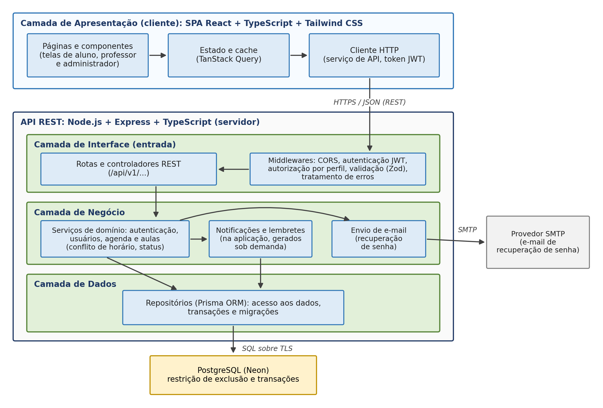
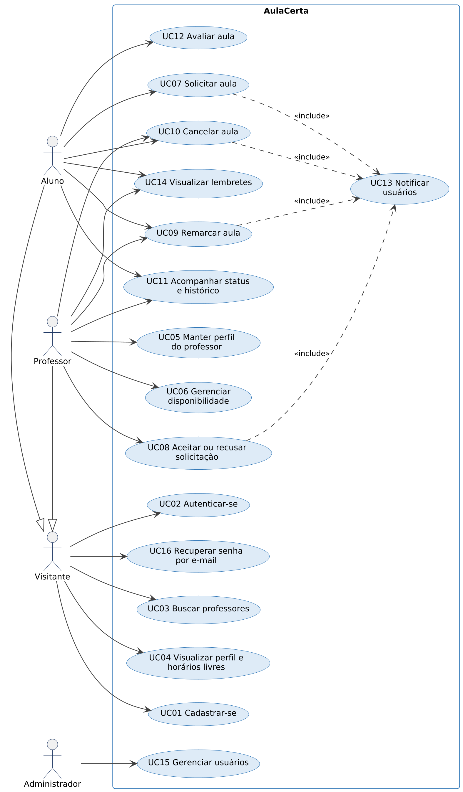
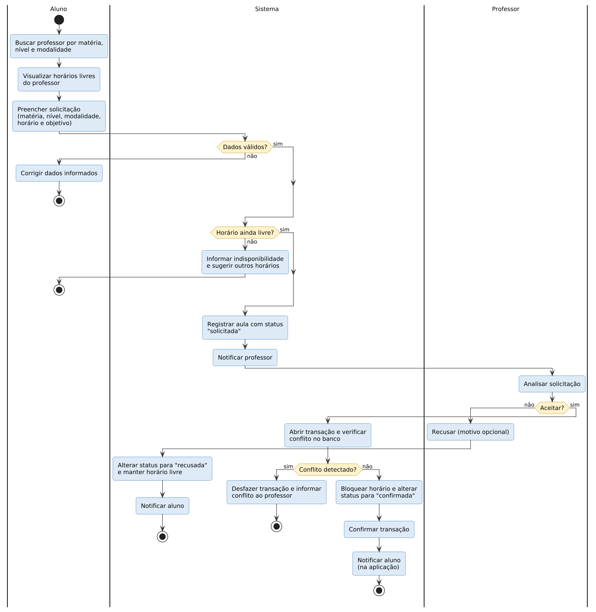
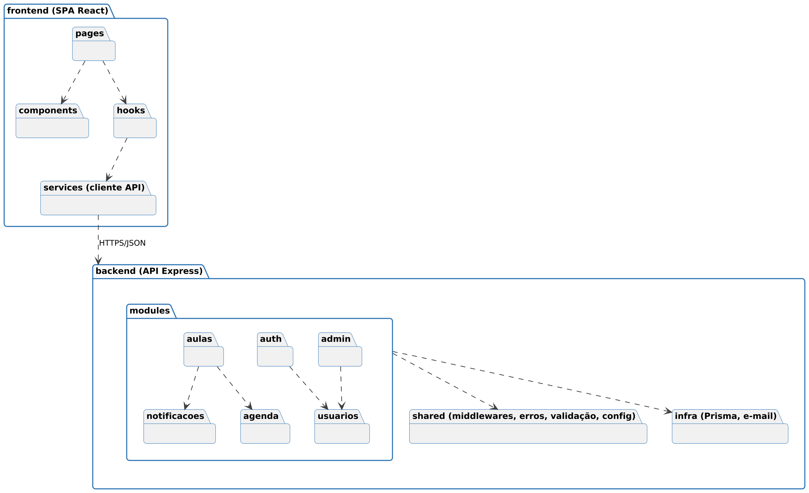
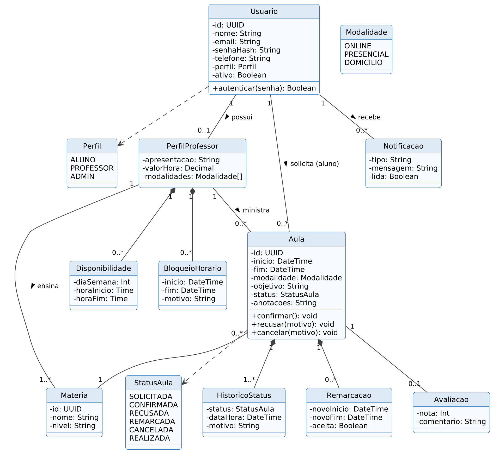
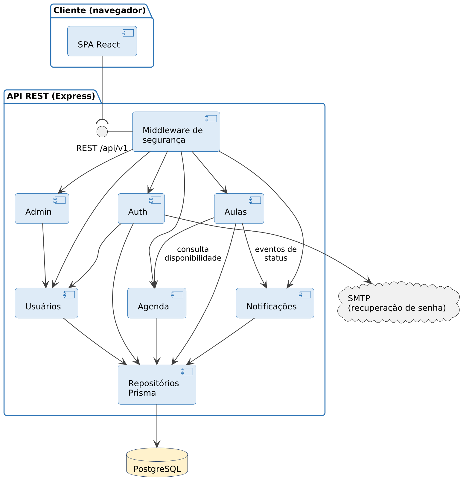
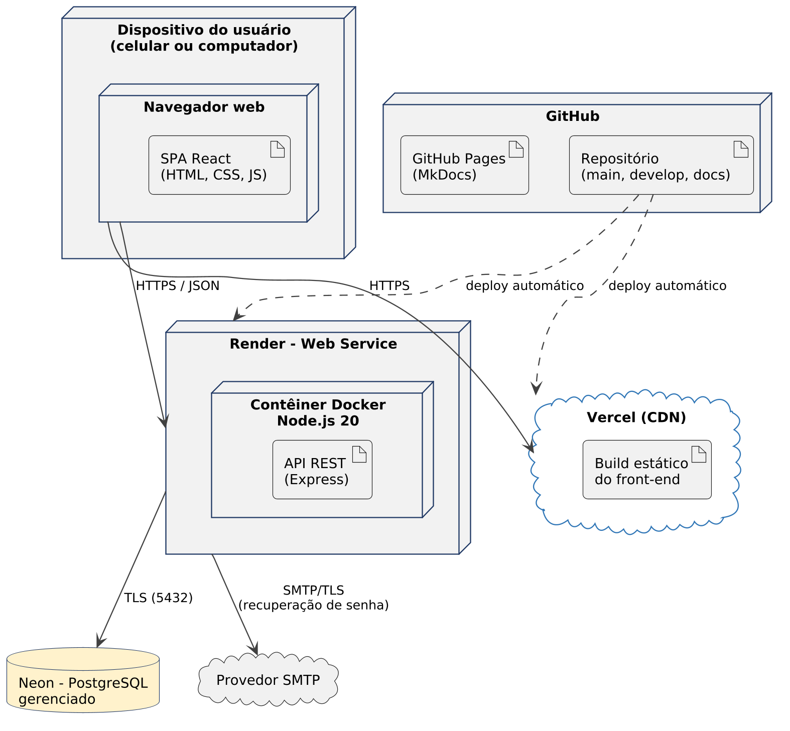

# Documento de Arquitetura

!!! note "Versão anterior"
    Esta é a versão 1.0 (02/10/2026), avaliada pelo professor. A versão atual é a [1.1](v1-1.md).

AulaCerta – Grupo Hopper

Versão 1.0

**Tabela - Integrantes do Grupo**

| Matricula | Nome | Função (responsabilidade) | Pontos de participação na elaboração |
|----|----|----|----|
| 232036401 | Pedro França de Lima | Scrum Master, Product Owner e Developer | 12,5 |
| 251037617 | Matheus Ferraz de Queiroz | Developer | 12,5 |
| 251014793 | Pedro Henrique Caldas Alves | Developer | 12,5 |
| 251037125 | Juliana Pereira de Rocha | Developer | 12,5 |
| 251016724 | Yasmim Ayres dos Santos Guedes | Developer | 12,5 |
| 251019780 | Daniel Valle Rodrigues Maia | Developer | 12,5 |
| 251039513 | Felipe Lima Sant’Ana | Developer | 12,5 |
| 242005418 | Pedro Henrique Rodrigues Pereira | Developer | 12,5 |
|  |  | **Total de pontos** | **100** |

**Histórico de Revisões**

| **Data** | **Versão** | **Descrição** | **Autor(es)** |
| --- | --- | --- | --- |
| **02/10/2026** | 1.0 | Versão inicial: estilo arquitetural, metas e restrições, visões de uso, lógica, estrutural e de implantação. | Equipe |

## 1 Introdução

### 1.1 Propósito

Este documento descreve a arquitetura do sistema desenvolvido pelo Grupo Hopper na disciplina FGA0312 – Métodos de Desenvolvimento de Software (UnB/FCTE), edição do segundo semestre de 2026, para o sistema AulaCerta, a fim de fornecer uma visão abrangente do sistema para desenvolvedores, testadores e demais interessados nos aspectos relacionados às tecnologias usadas no desenvolvimento.

### 1.2 Escopo

O detalhamento do escopo se encontra na seção 4 (Declaração de Escopo do Projeto) do Documento de Visão do Produto e do Projeto do AulaCerta, versão 1.0 (GRUPO HOPPER, 2026). Em linhas gerais, o escopo compreende uma aplicação web responsiva que centraliza a coordenação de aulas particulares entre alunos e professores: cadastro e autenticação, perfil e disponibilidade do professor, busca de professores, solicitação, confirmação, remarcação e cancelamento de aulas, acompanhamento por status, histórico, notificações e lembretes, além da administração da plataforma (cenários C01 a C07 e requisitos RF01 a RF22 e RNF01 a RNF06 daquele documento). Em relação à versão 1.0 do Documento de Visão, a equipe retirou o envio de notificações por e-mail (RF14): notificações e lembretes passam a ocorrer apenas dentro da aplicação, e o e-mail é usado somente para a recuperação de senha (RF03).

## 2 Representação Arquitetural

### 2.1 Definições

O sistema seguirá uma arquitetura **cliente-servidor**, na qual uma aplicação cliente do tipo SPA (Single Page Application), em React, se comunica por meio de uma **API REST** com um servidor em Node.js e Express, organizado internamente em **camadas** (interface, negócio e dados) e dividido em módulos funcionais, no formato de um **monólito modular**. Os dados são persistidos em um banco relacional PostgreSQL.

### 2.2 Justifique sua escolha.

A escolha considera o que foi definido no Documento de Visão do Produto e do Projeto (GRUPO HOPPER, 2026), referenciado a seguir por seção, quadro ou identificador:

- **Tecnologias já declaradas (Quadro 2 do Documento de Visão).** React, Node.js com Express e PostgreSQL com Prisma, hospedados separadamente, levam naturalmente a um cliente e a um servidor independentes que conversam por uma interface bem definida. O estilo REST é o mais simples e difundido para essa interface (FIELDING, 2000) e é o que os testes de integração com Supertest, previstos no Quadro 18 do Documento de Visão, pressupõem.

- **Prazo e produtividade (risco R03).** O desenvolvimento dispõe de cerca de sete semanas. Um único serviço de back-end, com TypeScript nos dois lados, simplifica a implantação, permite que qualquer integrante atue no front-end ou no back-end e concentra o esforço da equipe nas funcionalidades. Microsserviços trariam custos de comunicação, implantação e monitoramento sem benefício para o porte do sistema.

- **Regra central de confiabilidade (RF12 e métrica M4).** Impedir reservas sobrepostas exige que a regra fique em um ponto único e controlado. A camada de negócio concentra essa validação, e o banco relacional a reforça com transações e restrição de integridade, o que não seria possível se o cliente acessasse os dados diretamente.

- **Testabilidade e processo (seção 3 e Quadro 18 do Documento de Visão).** A separação em camadas permite testar as regras de negócio de forma isolada (testes unitários com TDD), a API com o banco (integração) e os fluxos pela interface (ponta a ponta), exatamente os níveis previstos na estratégia de testes.

- **Evolução (classe Won’t do Quadro 9 do Documento de Visão).** Um aplicativo móvel nativo está fora do escopo deste semestre. Com uma API REST independente, ele poderia ser construído no futuro reaproveitando todo o back-end.

A alternativa de uma aplicação full-stack única, sem API separada (por exemplo, Next.js), foi considerada e descartada: alteraria tecnologias já declaradas no Documento de Visão e acoplaria interface e servidor em um mesmo projeto.

### 2.3 Detalhamento

A Figura 1 representa o estilo arquitetural instanciado para o AulaCerta, com as camadas, seus componentes principais, as interfaces e os conectores utilizados.

**Figura 1 –** Estilo arquitetural do AulaCerta: cliente-servidor com API REST e back-end em camadas

**Fonte:** Elaborado pela equipe (2026).

Os elementos da Figura 1 são instanciados da seguinte forma: na camada de apresentação, a SPA é construída com React, TypeScript e Tailwind CSS e publicada como arquivos estáticos; no servidor, a API é implementada com Express em TypeScript, e cada requisição atravessa, em ordem, os middlewares, os controladores, os serviços e os repositórios; o acesso ao PostgreSQL é feito exclusivamente pelo Prisma. O Quadro 1 explica a responsabilidade de cada elemento, suas entradas e saídas e as regras de uso de suas interfaces.

**Quadro 1 –** Responsabilidades e interfaces dos elementos da arquitetura

| **Elemento** | **Responsabilidade** | **Entradas e saídas** | **Regras de uso** |
|----|----|----|----|
| Páginas e componentes (React) | Apresentar as telas de visitante, aluno, professor e administrador, de forma responsiva. | Entrada: ações do usuário. Saída: chamadas aos hooks de dados. | Componentes reutilizáveis; critérios básicos de acessibilidade (RNF05). |
| Estado e cache (TanStack Query) | Buscar, armazenar em cache e revalidar os dados, mantendo o status das aulas atualizado na tela. | Entrada: pedidos dos hooks. Saída: dados prontos para as telas. | Após cada alteração (aceitar, recusar, cancelar), o cache da consulta afetada é invalidado. |
| Cliente HTTP | Centralizar as chamadas à API, anexar o token de autenticação e tratar erros. | Entrada: requisições do front-end. Saída: respostas JSON. | URL base definida por ambiente; resposta 401 leva o usuário de volta ao login. |
| Middlewares | Aplicar CORS, autenticar o token JWT, autorizar por perfil, validar dados com Zod e padronizar erros. | Entrada: requisição HTTP. Saída: requisição validada ou erro 4xx no formato padrão. | Ordem fixa: CORS, autenticação, perfil, validação, controlador e tratamento de erros. |
| Rotas e controladores | Mapear cada rota REST para um caso de uso, traduzindo HTTP em chamadas aos serviços. | Entrada: requisição validada. Saída: resposta JSON e código de status. | Não contêm regra de negócio. |
| Serviços de domínio | Concentrar as regras: disponibilidade, conflito de horários, transições de status e verificação de que o usuário é dono do recurso. | Entrada: dados já validados. Saída: entidades ou erros de domínio. | Regras críticas desenvolvidas com TDD; nenhuma consulta direta ao banco. |
| Serviço de notificações | Gerar notificações na aplicação a partir de mudanças de status e gerar os lembretes das próximas aulas (RF19). | Entrada: eventos dos serviços e acessos do usuário. Saída: notificações e lembretes exibidos na aplicação. | Notificação gravada na mesma transação da mudança de status; lembretes gerados sob demanda, quando o usuário acessa a aplicação, sem duplicação. |
| Envio de e-mail | Enviar o link de recuperação de senha (RF03), a pedido do serviço de autenticação. | Entrada: endereço do usuário e link com token. Saída: e-mail entregue ao provedor SMTP. | Usado apenas para recuperação de senha; notificações não são enviadas por e-mail. |
| Repositórios (Prisma) | Executar consultas, gravações e transações no banco. | Entrada: consultas tipadas. Saída: entidades persistidas. | Único ponto de acesso ao banco; migrações versionadas no repositório. |
| PostgreSQL | Persistir os dados e garantir sua integridade. | Entrada e saída: comandos SQL sobre TLS. | Restrição de exclusão impede duas aulas confirmadas sobrepostas para o mesmo professor. |
| Provedor SMTP | Entregar o e-mail de recuperação de senha. | Entrada: mensagem enviada pelo Nodemailer. | Credenciais mantidas em variáveis de ambiente, fora do código. |

**Fonte:** Elaborado pela equipe (2026).

A interface entre cliente e servidor é a API REST. Todas as rotas usam o prefixo /api/v1, trocam dados em JSON e, exceto as públicas, exigem o token JWT no cabeçalho Authorization. O Quadro 2 apresenta as principais rotas e os requisitos do Documento de Visão que elas atendem.

**Quadro 2 –** Principais rotas da API REST (prefixo /api/v1)

| **Método** | **Rota** | **Descrição** | **Acesso** | **Requisito** |
|----|----|----|----|----|
| POST | /auth/cadastro | Cadastrar aluno ou professor | Público | RF01 |
| POST | /auth/login | Autenticar e obter token | Público | RF02 |
| POST | /auth/recuperar-senha | Enviar por e-mail o link de redefinição de senha | Público | RF03 |
| POST | /auth/redefinir-senha | Definir nova senha com o token recebido | Público (token) | RF03 |
| GET | /professores | Buscar professores (filtros: matéria, nível, modalidade) | Público | RF07 |
| GET | /professores/:id | Ver perfil e horários livres | Público | RF08 |
| PUT | /professores/me | Atualizar o próprio perfil de professor | Professor | RF04 |
| PUT | /professores/me/disponibilidade | Definir a grade semanal | Professor | RF05 |
| POST / DELETE | /professores/me/bloqueios | Criar ou remover bloqueio pontual | Professor | RF06 |
| POST | /aulas | Solicitar aula (ou série recorrente) | Aluno | RF09, RF10 |
| GET | /aulas | Listar as próprias aulas, com filtro por status | Aluno, Professor | RF17, RF18 |
| PATCH | /aulas/:id/aceitar | Aceitar solicitação (bloqueia o horário) | Professor | RF11, RF12 |
| PATCH | /aulas/:id/recusar | Recusar solicitação | Professor | RF11 |
| POST | /aulas/:id/remarcacoes | Propor novo horário | Aluno, Professor | RF15 |
| PATCH | /aulas/:id/remarcacoes/:rid | Aceitar ou recusar remarcação | Aluno, Professor | RF15 |
| PATCH | /aulas/:id/cancelar | Cancelar aula com motivo | Aluno, Professor | RF16 |
| PATCH | /aulas/:id/anotacoes | Registrar anotações da aula | Professor | RF20 |
| POST | /aulas/:id/avaliacao | Avaliar aula realizada | Aluno | RF21 |
| GET / PATCH | /notificacoes | Listar notificações e marcá-las como lidas | Aluno, Professor | RF13 |
| GET / PATCH | /admin/usuarios | Consultar, bloquear e excluir usuários | Administrador | RF22 |

**Fonte:** Elaborado pela equipe (2026).

### 2.4 Metas e restrições arquiteturais

O Quadro 3 identifica as metas e restrições que orientam a arquitetura, com a justificativa de cada uma.

**Quadro 3 –** Metas e restrições arquiteturais

| **Meta ou restrição** | **Definição** | **Justificativa** |
|----|----|----|
| Desempenho | 95% das requisições das telas principais (busca, perfil e painel) respondidas em até 2 s, com o serviço ativo. | Atende ao RNF04. Nos planos gratuitos de hospedagem, o serviço pode hibernar após um período sem uso, e a primeira requisição seguinte demora mais; por isso, a meta é medida com o serviço ativo. |
| Integridade da agenda | Nenhuma reserva confirmada sobreposta para o mesmo professor. | Atende ao RF12 e à métrica M4. A regra é validada no serviço e garantida no banco por transação e restrição de exclusão (POSTGRESQL GLOBAL DEVELOPMENT GROUP, 2026), mesmo com solicitações simultâneas. |
| Padrão da API | REST com JSON; prefixo /api/v1; recursos no plural; métodos HTTP com semântica correta; códigos 200, 201, 204, 400, 401, 403, 404, 409 (conflito de horário) e 422; erros no formato { erro: { codigo, mensagem, detalhes } }; datas em ISO 8601 (UTC); documentação OpenAPI. | Um contrato único e previsível reduz erros de integração entre front-end e back-end, facilita os testes com Supertest e permite que qualquer integrante entenda as rotas. |
| Segurança | HTTPS em todos os ambientes publicados; senhas com hash bcrypt; JWT com expiração curta; link de recuperação de senha com token de uso único e validade curta; segredos apenas em variáveis de ambiente. | Atende ao RNF03 e protege os dados pessoais tratados (RNF06). |
| Responsividade e acessibilidade | Interface utilizável a partir de 360 px de largura; critérios básicos da WCAG 2.1 AA. | Atende aos RNF02 e RNF05; o público usa principalmente o celular (W3C, 2018). |
| Qualidade do código | Cobertura de testes de no mínimo 70% nas regras de negócio, verificada antes de cada pull request e conferida na revisão. | Mantém a meta da métrica M6 e a Definição de Pronto do Documento de Visão. |

**Fonte:** Elaborado pela equipe (2026).

Além disso, a equipe adota o padrão de codificação do Quadro 4, válido para todo o código do repositório.

**Quadro 4 –** Padrão de codificação da equipe

| **Aspecto** | **Diretriz** | **Justificativa** |
|----|----|----|
| Linguagem | TypeScript em modo estrito no front-end e no back-end. | Erros de tipo são detectados antes da execução. |
| Formatação e análise estática | Prettier para formatação e ESLint com regras recomendadas, executados pelo desenvolvedor antes de abrir o pull request. | Código uniforme, independentemente do autor. |
| Nomenclatura | camelCase para variáveis e funções; PascalCase para classes, tipos e componentes React; kebab-case para nomes de arquivos; termos do domínio em português, sem acentos (Aula, Professor, Disponibilidade). | Aproxima o código do vocabulário do Documento de Visão e dos diagramas. |
| Organização | Back-end organizado por módulo (auth, usuarios, agenda, aulas, notificacoes, admin), cada um com rotas, controlador, serviço e repositório. | Cada integrante encontra o código de uma funcionalidade em um único lugar. |
| Versionamento | Branches main, develop e `feature/<id>-<descricao>`; commits no padrão Conventional Commits; todo código entra por pull request revisado. | Mantém a política da seção 3 do Documento de Visão. |

**Fonte:** Elaborado pela equipe (2026).

### 2.5 Visões

A arquitetura é comunicada por quatro visões complementares, inspiradas no modelo 4+1 (KRUCHTEN, 1995) e representadas em UML (OBJECT MANAGEMENT GROUP, 2017): a visão de uso, que resume o escopo; a visão de organização lógica, com os módulos e suas camadas; a visão estrutural, com a composição do sistema e as relações entre suas partes; e a visão de implantação, com o ambiente de execução.

#### 2.5.1 Visão de uso

O AulaCerta permite que visitantes encontrem professores e consultem horários livres; que alunos solicitem, remarquem, cancelem, acompanhem e avaliem aulas; que professores mantenham perfil e disponibilidade e decidam sobre as solicitações; e que administradores gerenciem os usuários. Alunos e professores também visualizam lembretes das próximas aulas. A Figura 2 apresenta o diagrama de casos de uso.

**Figura 2 –** Diagrama de casos de uso do AulaCerta

**Fonte:** Elaborado pela equipe (2026).

A funcionalidade mais complexa é a solicitação e confirmação de aula (UC07 e UC08), porque envolve dois atores, notificações e a regra de conflito de horários. A Figura 3 mostra seu diagrama de atividades: a disponibilidade é verificada quando o aluno solicita e verificada novamente, dentro de uma transação, quando o professor aceita, pois outro pedido pode ter sido confirmado nesse intervalo.

**Figura 3 –** Diagrama de atividades: solicitar e confirmar aula

**Fonte:** Elaborado pela equipe (2026).

**Quadro 5 –** Requisitos que influenciaram a escolha arquitetural

| **Requisito** | **Influência na arquitetura** |
|----|----|
| RF12 (impedir conflito) | Regra concentrada na camada de negócio e reforçada no banco por transação e restrição de exclusão. |
| RF13 e RF19 (notificações e lembretes) | Módulo de notificações separado, com avisos apenas na aplicação; lembretes gerados sob demanda, sem processo agendado, já que só são vistos dentro da aplicação e o serviço gratuito pode hibernar. |
| Perfis de acesso (Quadro 11 do Documento de Visão) | Middleware de autorização por perfil e verificação de dono do recurso nos serviços. |
| RNF02 e RNF05 (responsividade e acessibilidade) | SPA responsiva com Tailwind CSS, publicada em CDN. |
| RNF03 e RNF06 (segurança e privacidade) | JWT, bcrypt, HTTPS e coleta mínima de dados; contato do outro usuário visível apenas após a confirmação da aula. |
| RNF04 (desempenho) | Cache no cliente (TanStack Query) e índices nas consultas de busca e de agenda. |
| Risco R03 (prazo de desenvolvimento) | Monólito modular em uma única linguagem, com implantação simples. |

**Fonte:** Elaborado pela equipe (2026).

A escolha de uma única linguagem nos dois lados também favorece a organização da equipe: com TypeScript no front-end e no back-end, todos os integrantes podem revisar e contribuir em qualquer parte do código, em linha com a propriedade coletiva do código adotada no processo.

#### 2.5.2 Visão de organização lógica

O front-end é organizado em páginas (pages), componentes reutilizáveis (components), hooks de dados (hooks) e o cliente da API (services). O back-end é subdividido nos módulos auth, usuarios, agenda, aulas, notificacoes e admin, apoiados pelos pacotes shared e infra. Cada módulo corresponde a um ou mais cenários funcionais do Documento de Visão e contém suas próprias rotas, controlador, serviço e repositório, respeitando as camadas da Figura 1. O Quadro 6 explica a razão lógica de cada módulo e como ele se comunica.

**Quadro 6 –** Módulos do back-end: razão lógica e comunicação

| **Módulo** | **Razão lógica** | **Interfaces e comunicação** |
|----|----|----|
| auth | Cadastro, login, emissão do token e recuperação de senha por e-mail (C01). | /auth/\*; usa usuarios. |
| usuarios | Dados dos usuários e perfil do professor, com matérias, níveis e modalidades (C02). | /professores (perfil); usado por auth e admin. |
| agenda | Grade semanal, bloqueios pontuais e cálculo dos horários livres (C02). | /professores/me/disponibilidade e /bloqueios; consultado por aulas. |
| aulas | Solicitação, aceite, recusa, remarcação, cancelamento, anotações, avaliação e histórico de status (C03 a C06). | /aulas/\*; usa agenda e notificacoes. |
| notificacoes | Notificações na aplicação e lembretes das próximas aulas (C04 e C06). | /notificacoes; recebe eventos de aulas. |
| admin | Gestão de usuários e moderação de perfis (C07). | /admin/\*; usa usuarios. |
| shared | Middlewares, tratamento de erros, validação e configuração comuns a todos os módulos. | Importado pelos módulos. |
| infra | Cliente Prisma e envio de e-mail (Nodemailer), usado apenas na recuperação de senha. | Importado pelos repositórios e por auth. |

**Fonte:** Elaborado pela equipe (2026).

A comunicação entre front-end e back-end ocorre apenas pela API REST. Dentro do back-end, os módulos se comunicam por chamadas diretas aos serviços uns dos outros, nunca acessando o repositório de outro módulo: o módulo aulas, por exemplo, consulta os horários livres pelo serviço de agenda e informa as mudanças de status ao serviço de notificações. Essa regra evita dependências circulares e mantém cada módulo testável isoladamente. A Figura 4 apresenta o diagrama de pacotes.

**Figura 4 –** Diagrama de pacotes do AulaCerta

**Fonte:** Elaborado pela equipe (2026).

#### 2.5.3 Visão estrutural

A Figura 5 apresenta o diagrama de classes do domínio, que também orienta o modelo de dados no Prisma.

**Figura 5 –** Diagrama de classes do domínio

**Fonte:** Elaborado pela equipe (2026).

Usuario representa qualquer pessoa autenticada, e seu perfil (aluno, professor ou administrador) define as permissões. Quando o usuário é professor, ele possui um PerfilProfessor, que reúne as matérias ensinadas, a grade de Disponibilidade e os BloqueioHorario pontuais. Aula é a entidade central: liga um aluno a um professor e a uma matéria, guarda o intervalo de horário e o status atual e concentra as operações de confirmar, recusar e cancelar. Cada mudança de status gera um registro em HistoricoStatus, o que permite o acompanhamento e o histórico (RF17 e RF18). Remarcacao guarda as propostas de novo horário, Avaliacao guarda a nota do aluno e Notificacao registra os avisos enviados a cada usuário.

A Figura 6 apresenta o diagrama de componentes, que mostra como os módulos se conectam em tempo de execução.

**Figura 6 –** Diagrama de componentes do AulaCerta

**Fonte:** Elaborado pela equipe (2026).

A SPA consome a interface REST, e toda requisição passa pelo middleware de segurança antes de chegar aos componentes de domínio. O componente Aulas depende de Agenda, para verificar a disponibilidade, e de Notificações, para avisar sobre mudanças de status. Todos os componentes acessam o banco somente pelos repositórios Prisma, e apenas Auth se comunica com o provedor SMTP, para enviar o e-mail de recuperação de senha.

### 2.6 Visão de Implantação

O software será implantado em serviços de nuvem com planos gratuitos, o que atende ao critério de custo zero do Documento de Visão (seção 1.4) e permite que o professor e os monitores acessem a aplicação por um endereço HTTP, como exige o plano de ensino para soluções web. O front-end é servido pela Vercel; a API roda em um contêiner Docker no Render; o banco de dados é um PostgreSQL gerenciado no Neon. A Figura 7 apresenta o diagrama de implantação.

**Figura 7 –** Diagrama de implantação do AulaCerta

**Fonte:** Elaborado pela equipe (2026).

**Quadro 7 –** Infraestrutura de implantação

| **Parte** | **Tecnologia** | **Justificativa** |
|----|----|----|
| Front-end | Vercel (CDN) | Arquivos estáticos da SPA servidos por CDN, com HTTPS e implantação automática a partir do GitHub; plano gratuito. |
| API REST | Render – Web Service, em contêiner Docker com Node.js 20 | Executa o servidor Express; o Docker garante o mesmo ambiente em desenvolvimento e produção; plano gratuito. |
| Banco de dados | Neon – PostgreSQL gerenciado | PostgreSQL gerenciado com conexão TLS, cópias de segurança e plano gratuito; suporta a restrição de exclusão usada no RF12. |
| E-mail | Provedor SMTP | Envio do e-mail de recuperação de senha pelo Nodemailer; não há notificações por e-mail. |
| Documentação | GitHub Pages | Publicação da documentação do projeto em MkDocs. |

**Fonte:** Elaborado pela equipe (2026).

O PostgreSQL foi escolhido por ser relacional, o que se ajusta a um domínio com muitas relações entre usuários, agendas e aulas, e por oferecer transações e restrições de exclusão sobre intervalos de tempo, que garantem no próprio banco a ausência de reservas sobrepostas. Como o serviço gratuito do Render pode hibernar sem uso, os lembretes não dependem de um processo sempre ativo: eles são gerados sob demanda, quando o usuário acessa a aplicação, para as aulas confirmadas das próximas 24 horas.

Os ambientes acompanham a política de branches do Documento de Visão (Quadro 19), conforme o Quadro 8.

**Quadro 8 –** Ambientes de execução

| **Ambiente** | **Branch** | **Front-end** | **API e banco** |
|----|----|----|----|
| Local | feature/\* e fix/\* | Vite (servidor de desenvolvimento) | Docker Compose: API e PostgreSQL locais |
| Homologação | develop | Vercel (versão de pré-visualização) | Render e banco de homologação separado |
| Produção | main | Vercel (versão principal) | Render e banco Neon principal |

**Fonte:** Elaborado pela equipe (2026).

### 2.7 Restrições adicionais

**Restrições de negócio.** O AulaCerta é acessado diretamente pela Internet, sem intranet. A busca de professores e a consulta a perfis e horários livres são públicas; todas as demais funcionalidades exigem login. Por ser um projeto acadêmico, a infraestrutura é dimensionada para demonstrações e testes com dezenas de usuários simultâneos, sem meta formal de escala. A interface é em português, e os horários são armazenados em UTC e exibidos no fuso de Brasília. O pagamento das aulas não é tratado pela plataforma (classe Won’t do Documento de Visão).

As características de qualidade mais relevantes, segundo o modelo da ISO/IEC 25010 (INTERNATIONAL ORGANIZATION FOR STANDARDIZATION, 2011), estão no Quadro 9.

**Quadro 9 –** Características de qualidade relevantes (ISO/IEC 25010)

| **Característica** | **Como a arquitetura atende** | **Justificativa** |
|----|----|----|
| Usabilidade | SPA com poucos passos para reservar, status sempre visível e notificações. | É o critério de sucesso do produto: o fluxo precisa ser mais simples que a troca de mensagens (RNF01). |
| Confiabilidade | Transações e restrição de exclusão no banco; testes da regra de conflito. | Uma reserva duplicada destrói a confiança do usuário na agenda (RF12). |
| Segurança | Autenticação JWT, autorização por perfil e por dono do recurso, bcrypt e HTTPS. | Há dados pessoais e perfis com permissões diferentes (RNF03 e RNF06). |
| Eficiência de desempenho | Cache no cliente, índices e consultas paginadas. | Telas principais em até 2 s (RNF04). |
| Manutenibilidade | Camadas e módulos separados; padrão de codificação; cobertura de testes. | Oito integrantes trabalhando em paralelo por sete semanas. |
| Portabilidade | Interface web responsiva nos navegadores atuais; back-end em contêiner Docker. | Uso em celular e computador (RNF02) e o mesmo ambiente em todas as máquinas. |

**Fonte:** Elaborado pela equipe (2026).

**Segurança e perfis.** Como perfis diferentes acessam a aplicação, a autorização ocorre em dois níveis: o middleware verifica se o perfil pode usar a rota, e o serviço verifica se o usuário é dono do recurso (um aluno só vê as próprias aulas; um professor só decide sobre os pedidos feitos a ele). O Quadro 10 resume as permissões, coerentes com o Quadro 11 do Documento de Visão. Para proteger a privacidade (RNF06), telefone e e-mail do outro usuário só ficam visíveis depois que a aula é confirmada.

**Quadro 10 –** Permissões de acesso por perfil

| **Ação** | **Visitante** | **Aluno** | **Professor** | **Administrador** |
|----|----|----|----|----|
| Buscar professores e ver horários livres | Sim | Sim | Sim | Sim |
| Manter o próprio perfil | — | Sim | Sim | Sim |
| Gerenciar disponibilidade e bloqueios | — | — | Sim (própria) | — |
| Solicitar aula | — | Sim | — | — |
| Aceitar ou recusar solicitação | — | — | Sim (próprias aulas) | — |
| Remarcar ou cancelar aula | — | Sim (próprias aulas) | Sim (próprias aulas) | — |
| Ver status e histórico de aulas | — | Sim (próprias aulas) | Sim (próprias aulas) | — |
| Ver contato do outro usuário | — | Após confirmação | Após confirmação | — |
| Registrar anotações / avaliar aula | — | Avaliar (após realizada) | Anotar | — |
| Gerenciar usuários e moderar perfis | — | — | — | Sim |

**Fonte:** Elaborado pela equipe (2026).

## 3 Bibliografia

BASS, Len; CLEMENTS, Paul; KAZMAN, Rick. **Software architecture in practice**. 4. ed. Boston: Addison-Wesley, 2021.

BRASIL. **Lei nº 13.709, de 14 de agosto de 2018**. Lei Geral de Proteção de Dados Pessoais (LGPD). Brasília, DF: Presidência da República, 2018.

FIELDING, Roy Thomas. **Architectural styles and the design of network-based software architectures**. 2000. Tese (Doutorado em Information and Computer Science) – University of California, Irvine, 2000.

FOWLER, Martin. **Patterns of enterprise application architecture**. Boston: Addison-Wesley, 2002.

GRUPO HOPPER. **Documento de visão do produto e do projeto: AulaCerta**. Versão 1.0. Brasília: UnB/FCTE, 2026. Trabalho da disciplina FGA0312 – Métodos de Desenvolvimento de Software.

INTERNATIONAL ORGANIZATION FOR STANDARDIZATION. **ISO/IEC 25010:2011**: systems and software engineering – systems and software quality requirements and evaluation (SQuaRE) – system and software quality models. Geneva: ISO, 2011.

KRUCHTEN, Philippe. The 4+1 view model of architecture. **IEEE Software**, v. 12, n. 6, p. 42-50, 1995.

OBJECT MANAGEMENT GROUP. **OMG Unified Modeling Language (OMG UML)**: version 2.5.1. Needham: OMG, 2017.

POSTGRESQL GLOBAL DEVELOPMENT GROUP. **PostgreSQL documentation**: constraints. Disponível em: <https://www.postgresql.org/docs/current/ddl-constraints.html>. Acesso em: 2 out. 2026.

PRESSMAN, Roger S.; MAXIM, Bruce R. **Engenharia de software**: uma abordagem profissional. 8. ed. Porto Alegre: AMGH, 2016.

SOMMERVILLE, Ian. **Engenharia de software**. 10. ed. São Paulo: Pearson, 2018.

W3C. **Web Content Accessibility Guidelines (WCAG) 2.1**. 2018. Disponível em: <https://www.w3.org/TR/WCAG21/>. Acesso em: 2 out. 2026.
