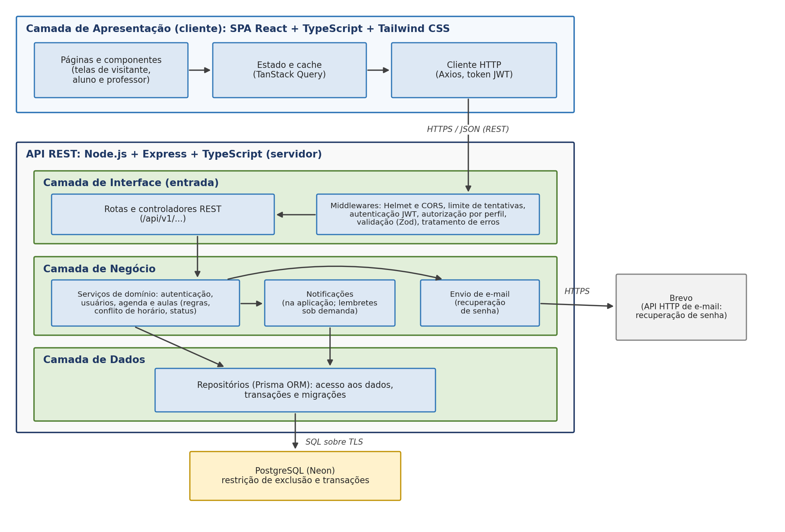
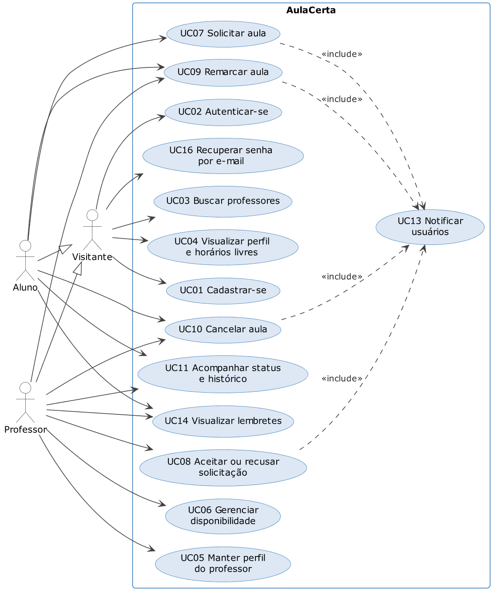
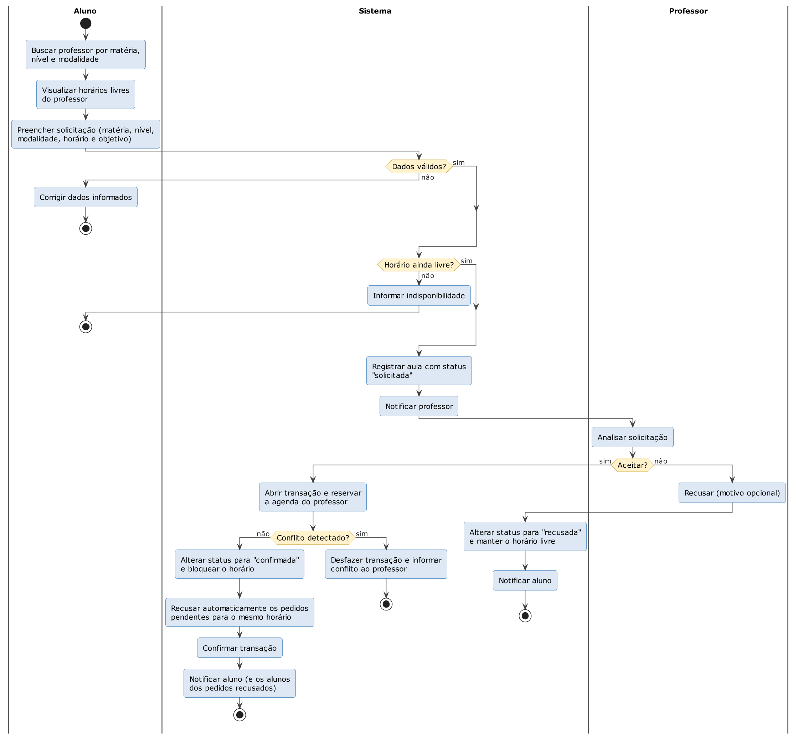
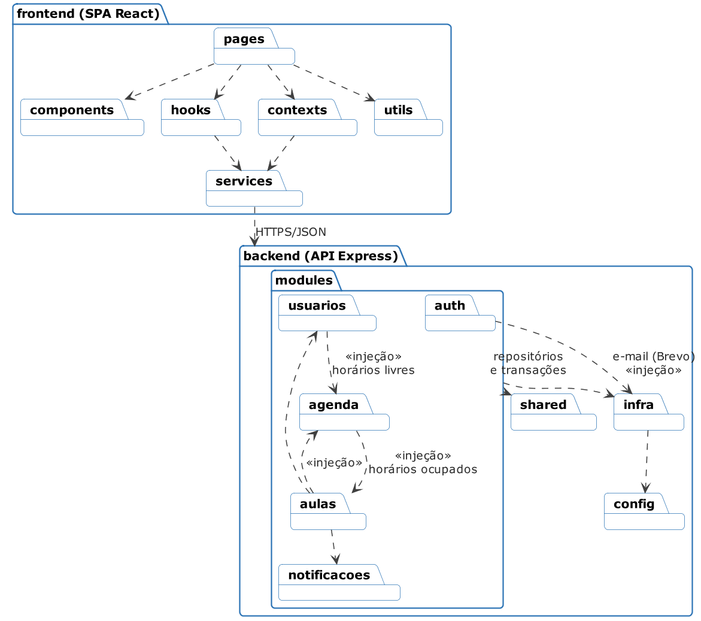
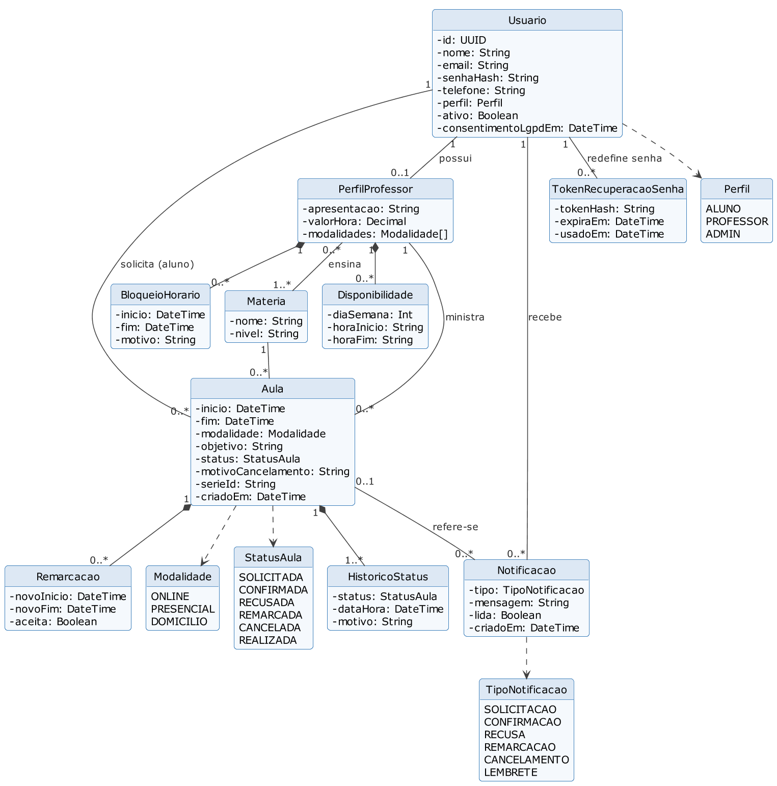
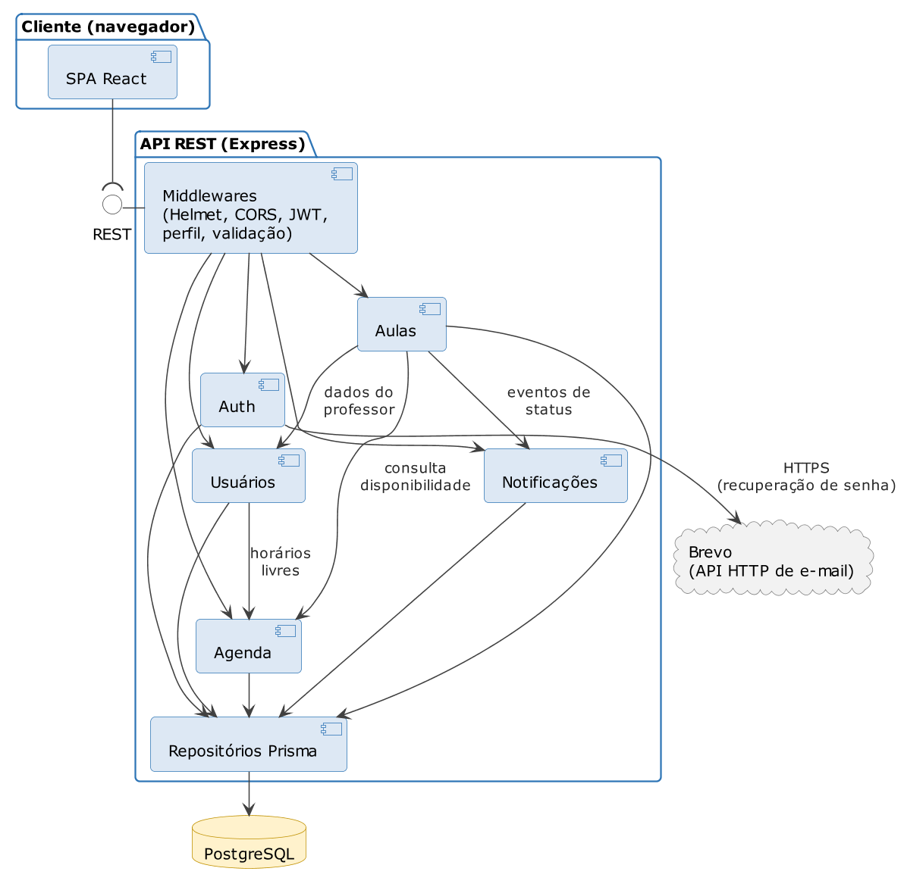
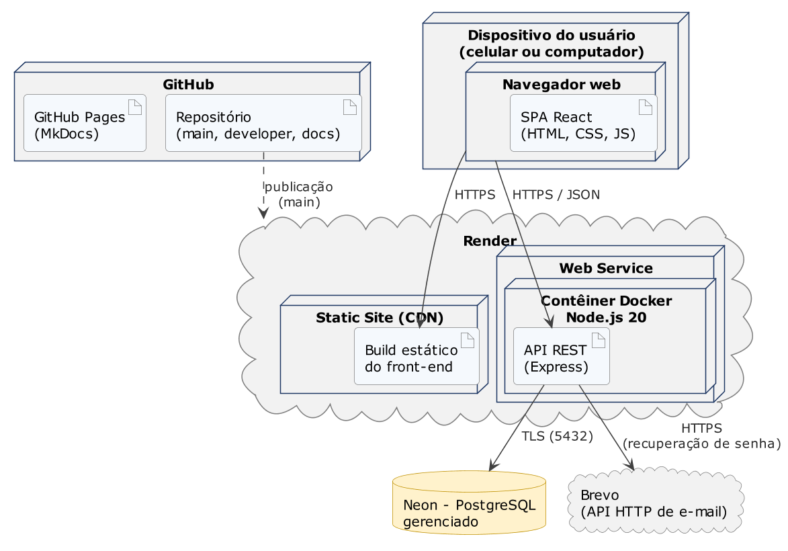

# Documento de Arquitetura

[Baixar em PDF](../assets/pdf/T02_Hopper_Documento_de_Arquitetura_1.1.pdf){ .md-button } Documento original da versão 1.1, nas normas ABNT.

AulaCerta – Grupo Hopper

Versão 1.1

**Tabela - Integrantes do Grupo**

| Matrícula | Nome | Função (responsabilidade) | Pontos de participação na elaboração |
|----|----|----|----|
| 232036401 | Pedro França de Lima | Scrum Master, Product Owner e Developer | 12,5 |
| 251037617 | Matheus Ferraz de Queiroz | Developer | 12,5 |
| 251014793 | Pedro Henrique Caldas Alves | Developer | 12,5 |
| 251037125 | Juliana Pereira de Rocha | Developer | 12,5 |
| 251016724 | Yasmim Ayres dos Santos Guedes | Developer | 12,5 |
| 251019780 | Daniel Valle Rodrigues Maia | Developer | 12,5 |
| 251039513 | Felipe Lima Sant’Ana | Developer | 12,5 |
| 242005418 | Pedro Henrique Rodrigues Pereira | Developer | 12,5 |
|  |  | **Total de pontos** | **100** |

**Histórico de Revisões**

| **Data** | **Versão** | **Descrição** | **Autor(es)** |
| --- | --- | --- | --- |
| **02/10/2026** | 1.0 | Versão inicial: estilo arquitetural, metas e restrições, visões de uso, lógica, estrutural e de implantação. | Equipe |
| **14/11/2026** | 1.1 | Revisão após a avaliação do documento, alinhada ao Documento de Visão 1.1 e ao código: e-mail de recuperação de senha pela API HTTP do Brevo, no lugar de SMTP e Nodemailer; Vitest no front-end e no back-end; contrato da API nos esquemas Zod, sem documentação OpenAPI; TDD retirado; meta de desempenho (RNF04) substituída por diretriz, com o efeito da hibernação explicado; critério de cobertura especificado; RNF01, RNF04, RNF05 e WCAG retirados; administração, anotações e avaliação de aulas fora do escopo (módulo admin, rotas, ator Administrador e classe Avaliacao); dependências entre módulos alinhadas ao código (Quadro 6 e Figura 4); regras de negócio atribuídas aos serviços e entidades sem operações (Quadro 1 e Figura 5); finalidade de cada visão delimitada, com menos repetições; rotas conferidas com o código; front-end publicado como site estático no Render, no lugar da Vercel (seção 2.6, Quadros 7 e 8 e Figura 7). | Equipe |

## 1 Introdução

### 1.1 Propósito

Este documento descreve a arquitetura do sistema desenvolvido pelo Grupo Hopper na disciplina FGA0312 – Métodos de Desenvolvimento de Software (UnB/FCTE), edição do segundo semestre de 2026, para o sistema AulaCerta, a fim de fornecer uma visão abrangente do sistema para desenvolvedores, testadores e demais interessados nos aspectos relacionados às tecnologias usadas no desenvolvimento.

### 1.2 Escopo

O detalhamento do escopo se encontra na seção 4 (Declaração de Escopo do Projeto) do Documento de Visão do Produto e do Projeto do AulaCerta, versão 1.1 (GRUPO HOPPER, 2026). Em linhas gerais, o escopo compreende uma aplicação web responsiva que centraliza a coordenação de aulas particulares entre alunos e professores: cadastro e autenticação, perfil e disponibilidade do professor, busca de professores, solicitação (inclusive de aulas semanais recorrentes), confirmação, remarcação e cancelamento de aulas e acompanhamento por status, histórico, notificações e lembretes. Isso corresponde aos cenários C01 a C06, aos requisitos funcionais do Quadro 14 e aos requisitos não funcionais RNF02 (responsividade), RNF03 (segurança) e RNF06 (privacidade) daquele documento. Notificações e lembretes ocorrem apenas dentro da aplicação; o e-mail é usado somente para a recuperação de senha (RF03). A administração da plataforma, as anotações e a avaliação de aulas estão fora do escopo do semestre.

## 2 Representação Arquitetural

### 2.1 Definições

O sistema segue uma arquitetura **cliente-servidor**, na qual uma aplicação cliente do tipo SPA (Single Page Application), em React, se comunica por meio de uma **API REST** com um servidor em Node.js e Express, organizado internamente em **camadas** (interface, negócio e dados) e dividido em módulos funcionais, no formato de um **monólito modular**. Os dados são persistidos em um banco relacional PostgreSQL.

### 2.2 Justifique sua escolha.

A escolha considera o que foi definido no Documento de Visão do Produto e do Projeto (GRUPO HOPPER, 2026), referenciado a seguir por seção, quadro ou identificador:

- **Tecnologias já declaradas (Quadro 2 do Documento de Visão).** React, Node.js com Express e PostgreSQL com Prisma, hospedados separadamente, levam naturalmente a um cliente e a um servidor independentes que conversam por uma interface bem definida. O estilo REST é o mais simples e difundido para essa interface (FIELDING, 2000) e é o que os testes de integração com Supertest pressupõem.

- **Prazo e produtividade (risco R03).** O desenvolvimento dispõe de cerca de sete semanas. Um único serviço de back-end, com TypeScript nos dois lados, simplifica a implantação, permite que qualquer integrante atue no front-end ou no back-end e concentra o esforço da equipe nas funcionalidades. Microsserviços trariam custos de comunicação, implantação e monitoramento sem benefício para o porte do sistema.

- **Regra central de confiabilidade (RF12 e métrica M4).** Impedir reservas sobrepostas exige que a regra fique em um ponto único e controlado. A camada de negócio concentra essa validação, e o banco relacional a reforça com transações e uma restrição de exclusão, o que não seria possível se o cliente acessasse os dados diretamente.

- **Testabilidade (seção 6 do Documento de Visão).** A separação em camadas permite testar as regras de negócio de forma isolada, com as dependências simuladas (testes unitários), a API com um banco de dados de teste (testes de integração) e os fluxos pela interface (testes de sistema), que são os níveis da estratégia de testes.

- **Evolução (classe Won’t do Quadro 9 do Documento de Visão).** Um aplicativo móvel nativo está fora do escopo deste semestre. Com uma API REST independente, ele poderia ser construído no futuro reaproveitando todo o back-end.

A alternativa de uma aplicação full-stack única, sem API separada (por exemplo, Next.js), foi considerada e descartada: alteraria tecnologias já declaradas no Documento de Visão e acoplaria interface e servidor em um mesmo projeto.

### 2.3 Detalhamento

Esta seção descreve as camadas e o papel de cada elemento; as visões da seção 2.5 mostram, cada uma, um aspecto que esta seção não detalha. A Figura 1 representa o estilo arquitetural instanciado para o AulaCerta, com as camadas, seus componentes principais, as interfaces e os conectores utilizados.

**Figura 1 –** Estilo arquitetural do AulaCerta: cliente-servidor com API REST e back-end em camadas

**Fonte:** Elaborado pela equipe (2026).

Na camada de apresentação, a SPA é construída com React, TypeScript e Tailwind CSS e publicada como arquivos estáticos. No servidor, a API é implementada com Express em TypeScript, e cada requisição atravessa, em ordem, os middlewares, os controladores, os serviços e os repositórios; o acesso ao PostgreSQL é feito exclusivamente pelo Prisma. O Quadro 1 explica a responsabilidade de cada elemento, suas entradas e saídas e as regras de uso de suas interfaces.

**Quadro 1 –** Responsabilidades e interfaces dos elementos da arquitetura

| **Elemento** | **Responsabilidade** | **Entradas e saídas** | **Regras de uso** |
|----|----|----|----|
| Páginas e componentes (React) | Apresentar as telas de visitante, aluno e professor, de forma responsiva. | Entrada: ações do usuário. Saída: chamadas aos hooks de dados. | Componentes reutilizáveis; telas utilizáveis a partir de 360 px de largura (RNF02). |
| Estado e cache (TanStack Query) | Buscar, armazenar em cache e revalidar os dados, mantendo o status das aulas atualizado na tela. | Entrada: pedidos dos hooks. Saída: dados prontos para as telas. | Após cada alteração (aceitar, recusar, salvar a grade), as consultas afetadas são invalidadas. |
| Cliente HTTP (Axios) | Centralizar as chamadas à API, anexar o token de autenticação e tratar erros. | Entrada: requisições do front-end. Saída: respostas JSON. | URL base definida por ambiente; resposta 401 leva o usuário de volta ao login. |
| Middlewares | Aplicar cabeçalhos de segurança (Helmet) e CORS, limitar tentativas de login e de recuperação de senha, autenticar o token JWT, autorizar por perfil, validar os dados com Zod e padronizar os erros. | Entrada: requisição HTTP. Saída: requisição validada ou erro 4xx no formato padrão. | Ordem fixa: cabeçalhos e CORS, limite de tentativas (quando houver), autenticação, perfil, validação e controlador; o tratamento de erros fica por último. |
| Rotas e controladores | Mapear cada rota REST para um caso de uso, traduzindo HTTP em chamadas aos serviços. | Entrada: requisição validada. Saída: resposta JSON e código de status. | Não contêm regra de negócio. |
| Serviços de domínio | Executar **todas as regras de negócio**: disponibilidade, conflito de horários, transições de status (consultando a tabela de transições permitidas do módulo aulas), recusa automática dos pedidos sobrepostos e verificação de que o usuário é dono do recurso. | Entrada: dados já validados. Saída: dados das entidades ou erros de domínio. | Recebem repositórios e outros serviços por injeção de dependência, o que permite testá-los com dependências simuladas; não acessam o banco diretamente. |
| Serviço de notificações | Gerar as notificações na aplicação a partir das mudanças de status (RF13) e, na Sprint 5, os lembretes das próximas aulas (RF19). | Entrada: chamadas do serviço de aulas. Saída: notificações exibidas na aplicação. | Notificação gravada na mesma transação da mudança de status, com chave única que impede duplicação. |
| Envio de e-mail | Enviar o link de recuperação de senha (RF03), a pedido do serviço de autenticação. | Entrada: endereço do usuário e link com token. Saída: mensagem entregue ao Brevo pela API HTTP. | Usado apenas para recuperação de senha; notificações não são enviadas por e-mail. |
| Repositórios (Prisma) | Executar consultas, gravações e transações no banco. | Entrada: consultas tipadas. Saída: dados persistidos. | Único ponto de acesso ao banco; migrações versionadas no repositório. |
| PostgreSQL | Persistir os dados e garantir sua integridade. | Entrada e saída: comandos SQL sobre TLS. | Restrição de exclusão impede duas aulas confirmadas ou remarcadas sobrepostas para o mesmo professor. |
| Brevo (serviço externo de e-mail) | Entregar o e-mail de recuperação de senha. | Entrada: mensagem enviada pela API HTTP do Brevo. | Chave de acesso mantida em variável de ambiente, fora do código. |

**Fonte:** Elaborado pela equipe (2026).

A interface entre cliente e servidor é a API REST. Todas as rotas usam o prefixo `/api/v1`, trocam dados em JSON e, exceto as públicas, exigem o token JWT no cabeçalho `Authorization`. O Quadro 2 apresenta as rotas e os requisitos do Documento de Visão que elas atendem; as rotas de remarcação e cancelamento são da Sprint 5.

**Quadro 2 –** Rotas da API REST (prefixo `/api/v1`)

| **Método** | **Rota** | **Descrição** | **Acesso** | **Requisito** |
|----|----|----|----|----|
| `POST` | `/auth/cadastro` | Cadastrar aluno ou professor, com consentimento | Público | RF01, RNF06 |
| `POST` | `/auth/login` | Autenticar e obter o token | Público | RF02 |
| `GET` | `/auth/me` | Consultar o usuário autenticado | Autenticado | RF02 |
| `POST` | `/auth/recuperar-senha` | Enviar por e-mail o link de redefinição de senha | Público | RF03 |
| `POST` | `/auth/redefinir-senha` | Definir nova senha com o token recebido | Público (token) | RF03 |
| `PUT` | `/usuarios/me` | Atualizar nome e telefone da própria conta | Autenticado | RF01 |
| `GET` | `/materias` | Listar as matérias e os níveis | Público | RF04, RF07 |
| `GET` | `/professores` | Buscar professores (filtros: matéria, nível e modalidade) | Público | RF07 |
| `GET` | `/professores/:id` | Ver perfil e horários livres | Público | RF08 |
| `GET` | `/professores/me` | Consultar o próprio perfil de professor | Professor | RF04 |
| `PUT` | `/professores/me` | Atualizar o próprio perfil de professor | Professor | RF04 |
| `GET` | `/professores/me/disponibilidade` | Consultar a grade semanal | Professor | RF05 |
| `PUT` | `/professores/me/disponibilidade` | Substituir a grade semanal | Professor | RF05 |
| `GET` | `/professores/me/bloqueios` | Listar os bloqueios futuros | Professor | RF06 |
| `POST` | `/professores/me/bloqueios` | Criar bloqueio pontual | Professor | RF06 |
| `DELETE` | `/professores/me/bloqueios/:id` | Remover bloqueio pontual | Professor | RF06 |
| `POST` | `/aulas` | Solicitar aula ou série semanal | Aluno | RF09, RF10 |
| `GET` | `/aulas` | Listar as próprias aulas (filtros: status e período) | Aluno, Professor | RF17, RF18 |
| `GET` | `/aulas/:id` | Ver detalhes, histórico e contato liberado | Aluno, Professor | RF17, RNF06 |
| `PATCH` | `/aulas/:id/aceitar` | Aceitar solicitação (ou a série) e bloquear o horário | Professor | RF11, RF12 |
| `PATCH` | `/aulas/:id/recusar` | Recusar solicitação | Professor | RF11 |
| `POST` | `/aulas/:id/remarcacoes` | Propor novo horário (Sprint 5) | Aluno, Professor | RF15 |
| `PATCH` | `/aulas/:id/remarcacoes/:rid` | Aceitar ou recusar remarcação (Sprint 5) | Aluno, Professor | RF15 |
| `PATCH` | `/aulas/:id/cancelar` | Cancelar aula com motivo (Sprint 5) | Aluno, Professor | RF16 |
| `GET` | `/notificacoes` | Listar notificações | Aluno, Professor | RF13 |
| `PATCH` | `/notificacoes` | Marcar notificações como lidas | Aluno, Professor | RF13 |
| `GET` | `/saude` | Verificar se a API está no ar | Público | — |

**Fonte:** Elaborado pela equipe (2026).

### 2.4 Metas e restrições arquiteturais

O Quadro 3 identifica as metas e restrições que orientam a arquitetura, com a justificativa de cada uma.

**Quadro 3 –** Metas e restrições arquiteturais

| **Meta ou restrição** | **Definição** | **Justificativa** |
|----|----|----|
| Integridade da agenda | Nenhuma reserva confirmada sobreposta para o mesmo professor, mesmo com aceites simultâneos. | Atende ao RF12 e à métrica M4. O aceite reserva a agenda do professor dentro de uma transação, e o banco garante a regra com uma restrição de exclusão (POSTGRESQL GLOBAL DEVELOPMENT GROUP, 2026); conflitos entre transações respondem 409. |
| Padrão da API | REST com JSON; prefixo `/api/v1`; códigos 200, 201, 204, 400, 401, 403, 404, 409 (conflito), 422 (validação) e 429 (excesso de tentativas); erros no formato `{ erro: { codigo, mensagem, detalhes } }`; datas em ISO 8601 no horário de Brasília (−03:00). | Um contrato único e previsível reduz erros de integração entre front-end e back-end. O contrato de cada rota fica nos esquemas de validação Zod do back-end e é verificado pelos testes de integração. |
| Segurança | HTTPS nos ambientes publicados; senhas com hash bcrypt; JWT com validade curta (padrão de 2 horas, definida por variável de ambiente); link de recuperação de senha de uso único, válido por 1 hora e guardado apenas como hash; limite de tentativas no login e na recuperação de senha; segredos apenas em variáveis de ambiente. | Atende ao RNF03. |
| Privacidade | Consentimento registrado no cadastro; perfil público sem e-mail e telefone; contato do outro participante liberado somente após a confirmação da aula. | Atende ao RNF06 e à LGPD (BRASIL, 2018). |
| Responsividade | Telas principais utilizáveis a partir de 360 px de largura, sem rolagem horizontal. | Atende ao RNF02; o público usa principalmente o celular. |
| Qualidade do código | Cobertura mínima de 70% em quatro critérios medidos pelo Vitest: instruções, ramificações, funções e linhas. No back-end, a medição inclui os serviços de domínio (`src/modules/**/*.service.ts`), onde estão as regras de negócio; no front-end, todo o `src`, exceto os testes e os arquivos de inicialização. | Mantém a métrica M6 e a Definição de Pronto do Documento de Visão. Abaixo de 70% em qualquer critério, o comando de cobertura falha. |

**Fonte:** Elaborado pela equipe (2026).

**Desempenho como diretriz.** O projeto não estabelece meta de desempenho com compromisso de teste. As telas usam cache no cliente, consultas paginadas e índices nas buscas de professores e de agenda. Há, porém, um efeito que o usuário percebe: no plano gratuito do Render, a API hiberna após cerca de 15 minutos sem requisições, e a primeira requisição depois disso espera o serviço reiniciar, o que pode levar dezenas de segundos; as seguintes voltam ao tempo normal. Para reduzir esse efeito, o front-end mostra um indicador de carregamento enquanto aguarda a resposta, e, antes de demonstrações, a equipe acessa a rota `/saude` para reativar o serviço.

Além disso, a equipe adota o padrão de codificação do Quadro 4, válido para todo o código do repositório.

**Quadro 4 –** Padrão de codificação da equipe

| **Aspecto** | **Diretriz** | **Justificativa** |
|----|----|----|
| Linguagem | TypeScript em modo estrito no front-end e no back-end. | Erros de tipo são detectados antes da execução. |
| Formatação e análise estática | Prettier para formatação e ESLint com regras recomendadas, executados pelo desenvolvedor antes de abrir o pull request. | Código uniforme, independentemente do autor. |
| Nomenclatura | camelCase para variáveis e funções; PascalCase para classes, tipos e componentes React; kebab-case para nomes de arquivos; termos do domínio em português, sem acentos (Aula, Professor, Disponibilidade). | Aproxima o código do vocabulário do Documento de Visão e dos diagramas. |
| Organização | Back-end organizado por módulo (auth, usuarios, agenda, aulas e notificacoes), cada um com rotas, controlador, serviço, repositório e esquemas de validação; testes unitários ao lado do arquivo testado. | Cada integrante encontra o código de uma funcionalidade em um único lugar. |
| Versionamento | Branches main, developer e `feature/<descricao>` (correções em `fix/<descricao>`, testes em `test/<descricao>`); commits no padrão Conventional Commits; todo código entra por pull request revisado. | Mantém a política da seção 3 do Documento de Visão. |

**Fonte:** Elaborado pela equipe (2026).

### 2.5 Visões

A arquitetura é comunicada por quatro visões complementares, inspiradas no modelo 4+1 (KRUCHTEN, 1995) e representadas em UML (OBJECT MANAGEMENT GROUP, 2017). Cada visão responde a uma pergunta diferente:

- **visão de uso (2.5.1):** o que o sistema faz e para quem, e como acontece o fluxo mais complexo;
- **visão de organização lógica (2.5.2):** como o código está dividido e quais módulos dependem de quais;
- **visão estrutural (2.5.3):** quais dados o sistema guarda e quais componentes se conectam em execução;
- **visão de implantação (2.6):** onde cada parte roda e em quais ambientes.

#### 2.5.1 Visão de uso

O AulaCerta permite que visitantes encontrem professores e consultem horários livres; que alunos solicitem, remarquem, cancelem e acompanhem aulas; e que professores mantenham perfil e disponibilidade e decidam sobre as solicitações. Alunos e professores também recebem notificações e visualizam lembretes das próximas aulas. A Figura 2 apresenta o diagrama de casos de uso.

**Figura 2 –** Diagrama de casos de uso do AulaCerta

**Fonte:** Elaborado pela equipe (2026).

A numeração dos casos de uso não é contínua porque casos retirados em revisões anteriores mantiveram seus números (ver o Histórico de Revisões).

A funcionalidade mais complexa é a solicitação e confirmação de aula (UC07 e UC08), porque envolve dois atores, notificações e a regra de conflito de horários. A Figura 3 mostra seu diagrama de atividades: a disponibilidade é verificada quando o aluno solicita e verificada novamente, dentro de uma transação, quando o professor aceita, pois outro pedido pode ter sido confirmado nesse intervalo. Ao confirmar, o sistema também recusa automaticamente os outros pedidos pendentes para o mesmo horário.

**Figura 3 –** Diagrama de atividades: solicitar e confirmar aula

**Fonte:** Elaborado pela equipe (2026).

O Quadro 5 relaciona os requisitos de uso que mais influenciaram a arquitetura.

**Quadro 5 –** Requisitos que influenciaram a escolha arquitetural

| **Requisito** | **Influência na arquitetura** |
|----|----|
| RF12 (impedir conflito) | Regra concentrada na camada de negócio e reforçada no banco por transação e restrição de exclusão. |
| RF13 e RF19 (notificações e lembretes) | Módulo de notificações separado, com avisos apenas na aplicação; lembretes gerados sob demanda, sem processo agendado, já que só são vistos dentro da aplicação e o serviço gratuito pode hibernar. |
| Perfis de acesso (Quadro 11 do Documento de Visão) | Middleware de autorização por perfil e verificação de dono do recurso nos serviços. |
| RNF02 (responsividade) | SPA responsiva com Tailwind CSS, publicada em CDN. |
| RNF03 e RNF06 (segurança e privacidade) | JWT, bcrypt, HTTPS, limite de tentativas e coleta mínima de dados; contato do outro usuário visível apenas após a confirmação da aula. |
| Risco R03 (prazo de desenvolvimento) | Monólito modular em uma única linguagem, com implantação simples. |
| Risco R09 (planos gratuitos) | E-mail pela API HTTP do Brevo, porque a hospedagem gratuita bloqueia as portas SMTP; lembretes sem processo sempre ativo. |

**Fonte:** Elaborado pela equipe (2026).

#### 2.5.2 Visão de organização lógica

Esta visão mostra como o código está dividido e as dependências entre as partes. O front-end é organizado em páginas (pages), componentes reutilizáveis (components), hooks de dados (hooks), contextos (contexts, como a sessão do usuário), utilitários (utils) e o cliente da API (services). O back-end é subdividido nos módulos auth, usuarios, agenda, aulas e notificacoes, apoiados pelos pacotes shared, infra e config. O Quadro 6 explica a razão lógica de cada parte e de quais outras ela depende.

**Quadro 6 –** Módulos do back-end: razão lógica e dependências

| **Módulo ou pacote** | **Razão lógica** | **Interfaces e dependências** |
|----|----|----|
| auth | Cadastro, login, emissão do token e recuperação de senha (C01). | Rotas `/auth/*`. Usa shared; seu repositório usa infra (Prisma), e o envio de e-mail (infra) é injetado na criação do serviço. |
| usuarios | Dados da conta e perfil do professor, com matérias, níveis e modalidades (C02), e a busca de professores (C03). | Rotas `/usuarios/me`, `/professores` e `/materias`. Usa shared e infra; consulta os horários livres em agenda. |
| agenda | Grade semanal, bloqueios pontuais e cálculo dos horários livres (C02). | Rotas `/professores/me/disponibilidade` e `/professores/me/bloqueios`. Usa shared e infra; consulta os horários ocupados em aulas. |
| aulas | Solicitação, aceite e recusa (C03 e C04), além de remarcação e cancelamento (C05, Sprint 5), com o histórico de status. | Rotas `/aulas/*`. Usa usuarios, agenda e notificacoes, além de shared e infra (repositório e transações). |
| notificacoes | Notificações na aplicação e lembretes das próximas aulas (C04 e C06). | Rotas `/notificacoes`. Usa shared e infra; é chamado por aulas dentro da transação. |
| shared | Middlewares, erros, tipos e utilitários comuns (datas, paginação, segurança e validações). | Usado por todos os módulos. |
| infra | Cliente Prisma e transações; envio de e-mail pelo Brevo. | Usado pelos repositórios de todos os módulos e pelos serviços de aulas e notificacoes; o envio de e-mail é usado por auth. |
| config | Variáveis de ambiente validadas e mensagens de validação em português. | Usado por infra e na inicialização da API. |

**Fonte:** Elaborado pela equipe (2026).

A comunicação entre front-end e back-end ocorre apenas pela API REST. Dentro do back-end, um módulo nunca acessa o repositório de outro: ele chama o serviço do outro módulo. As dependências que formariam um ciclo (aulas consulta a agenda, e a agenda precisa saber quais horários as aulas já ocupam) são ligadas no ponto de montagem da aplicação, por injeção de dependência: cada serviço declara apenas a interface de que precisa. Assim, não há importação circular, e cada serviço é testado isoladamente. A Figura 4 apresenta o diagrama de pacotes com essas dependências.

**Figura 4 –** Diagrama de pacotes do AulaCerta

**Fonte:** Elaborado pela equipe (2026).

#### 2.5.3 Visão estrutural

Esta visão mostra os dados que o sistema guarda e os componentes que se conectam em execução. A Figura 5 apresenta o diagrama de classes do domínio, que corresponde ao modelo de dados do Prisma.

**Figura 5 –** Diagrama de classes do domínio

**Fonte:** Elaborado pela equipe (2026).

Usuario representa qualquer pessoa autenticada, e seu perfil (aluno ou professor) define as permissões. Quando o usuário é professor, ele possui um PerfilProfessor, que reúne as matérias ensinadas, a grade de Disponibilidade e os BloqueioHorario pontuais. Aula é a entidade central: liga um aluno a um professor e a uma matéria e guarda o intervalo de horário, a modalidade, o objetivo e o status atual; aulas da mesma série semanal compartilham um identificador de série. Cada mudança de status gera um registro em HistoricoStatus, o que permite o acompanhamento e o histórico (RF17 e RF18). Remarcacao guarda as propostas de novo horário, Notificacao registra os avisos de cada usuário e TokenRecuperacaoSenha guarda, apenas como hash, os links de redefinição de senha.

As classes do domínio guardam apenas dados e não têm operações. Os comportamentos, como confirmar, recusar, remarcar e cancelar uma aula, são executados pelos serviços de domínio (Quadro 1), que consultam a tabela de transições de status permitidas e gravam a mudança e seu histórico na mesma transação. Essa divisão mantém as regras em um único lugar e permite testá-las sem o banco de dados.

A Figura 6 apresenta o diagrama de componentes, que mostra quais componentes se conectam em tempo de execução e quais interfaces usam.

**Figura 6 –** Diagrama de componentes do AulaCerta

**Fonte:** Elaborado pela equipe (2026).

A SPA consome a interface REST, e toda requisição passa pelos middlewares antes de chegar aos componentes de domínio. Somente o componente Auth usa o serviço externo de e-mail (Brevo).

### 2.6 Visão de Implantação

Esta visão mostra onde cada parte do sistema roda. O software é implantado em serviços de nuvem com planos gratuitos, o que atende ao critério de custo zero do Documento de Visão (seção 1.4) e permite que o professor e os monitores acessem a aplicação por um endereço HTTP, como exige o plano de ensino para soluções web. O front-end e a API ficam no Render: o front-end como site estático (Static Site), servido por CDN, e a API em um contêiner Docker (Web Service); o banco de dados é um PostgreSQL gerenciado no Neon; o e-mail de recuperação de senha é enviado pela API HTTP do Brevo. A Figura 7 apresenta o diagrama de implantação.

**Figura 7 –** Diagrama de implantação do AulaCerta

**Fonte:** Elaborado pela equipe (2026).

**Quadro 7 –** Infraestrutura de implantação

| **Parte** | **Tecnologia** | **Justificativa** |
|----|----|----|
| Front-end | Render – Static Site (CDN) | Arquivos estáticos da SPA servidos por CDN, com HTTPS e regra de reescrita que entrega o `index.html` para as rotas do React Router; plano gratuito, sem hibernação. |
| API REST | Render – Web Service, em contêiner Docker com Node.js 20 | Executa o servidor Express; o Docker garante o mesmo ambiente em desenvolvimento e em produção; plano gratuito, com hibernação após inatividade (seção 2.4). |
| Banco de dados | Neon – PostgreSQL gerenciado | PostgreSQL com conexão TLS e plano gratuito; suporta a restrição de exclusão usada no RF12 e permite criar um banco separado para os testes. |
| E-mail | Brevo – API HTTP | Envio do e-mail de recuperação de senha por HTTPS. O plano gratuito do Render bloqueia as portas SMTP, por isso o envio não usa SMTP (risco R09 do Documento de Visão). |
| Documentação | GitHub Pages | Publicação da documentação do projeto em MkDocs. |

**Fonte:** Elaborado pela equipe (2026).

O PostgreSQL foi escolhido por ser relacional, o que se ajusta a um domínio com muitas relações entre usuários, agendas e aulas, e por oferecer transações e restrições de exclusão sobre intervalos de tempo, que garantem no próprio banco a ausência de reservas sobrepostas. Como a API pode hibernar, os lembretes não dependem de um processo sempre ativo: eles são gerados sob demanda, quando o usuário acessa a aplicação.

Os ambientes acompanham a política de branches do Documento de Visão (Quadro 19), conforme o Quadro 8.

**Quadro 8 –** Ambientes de execução

| **Ambiente** | **Branch** | **Front-end** | **API e banco** |
|----|----|----|----|
| Local | `feature/*`, `fix/*` e `test/*` | Vite (servidor de desenvolvimento) | API local, com banco de desenvolvimento no Neon ou PostgreSQL local pelo Docker Compose |
| Testes | qualquer branch, na máquina do desenvolvedor | Vite, iniciado pelos testes de sistema | API local, com um banco de teste separado no Neon, apagado a cada execução |
| Produção | main | Render – Static Site | Render – Web Service e banco Neon principal |

**Fonte:** Elaborado pela equipe (2026).

### 2.7 Restrições adicionais

**Restrições de negócio.** O AulaCerta é acessado diretamente pela Internet, sem intranet. A busca de professores e a consulta a perfis e horários livres são públicas; todas as demais funcionalidades exigem login. Por ser um projeto acadêmico, a infraestrutura é dimensionada para demonstrações e testes, sem meta de escala nem de desempenho (seção 2.4). A interface é em português, e as datas são gravadas com fuso horário e exibidas no horário de Brasília. O pagamento das aulas não é tratado pela plataforma (classe Won’t do Documento de Visão).

As características de qualidade mais relevantes, segundo o modelo da ISO/IEC 25010 (INTERNATIONAL ORGANIZATION FOR STANDARDIZATION, 2011), estão no Quadro 9.

**Quadro 9 –** Características de qualidade relevantes (ISO/IEC 25010)

| **Característica** | **Como a arquitetura atende** | **Justificativa** |
|----|----|----|
| Usabilidade | SPA com poucos passos para reservar, status sempre visível e notificações. | Diretriz de projeto do Documento de Visão (seção 1.1): o fluxo precisa ser mais simples que a troca de mensagens. |
| Confiabilidade | Transações, bloqueio da agenda e restrição de exclusão no banco; testes da regra de conflito, inclusive com aceites simultâneos. | Uma reserva duplicada destrói a confiança do usuário na agenda (RF12). |
| Segurança | Autenticação JWT, autorização por perfil e por dono do recurso, bcrypt, limite de tentativas e HTTPS. | Há dados pessoais e perfis com permissões diferentes (RNF03 e RNF06). |
| Manutenibilidade | Camadas e módulos separados; padrão de codificação; cobertura de testes. | Oito integrantes trabalhando em paralelo por sete semanas. |
| Portabilidade | Interface web responsiva nos navegadores atuais; back-end em contêiner Docker. | Uso em celular e computador (RNF02) e o mesmo ambiente em todas as máquinas. |

**Fonte:** Elaborado pela equipe (2026).

**Segurança e perfis.** Como perfis diferentes acessam a aplicação, a autorização ocorre em dois níveis: o middleware verifica se o perfil pode usar a rota, e o serviço verifica se o usuário é dono do recurso (um aluno só vê as próprias aulas; um professor só decide sobre os pedidos feitos a ele). O Quadro 10 resume as permissões, coerentes com o Quadro 11 do Documento de Visão. Para proteger a privacidade (RNF06), telefone e e-mail do outro usuário só ficam visíveis depois que a aula é confirmada.

**Quadro 10 –** Permissões de acesso por perfil

| **Ação** | **Visitante** | **Aluno** | **Professor** |
|----|----|----|----|
| Buscar professores e ver horários livres | Sim | Sim | Sim |
| Manter os dados da própria conta | — | Sim | Sim |
| Manter o perfil de professor | — | — | Sim (próprio) |
| Gerenciar disponibilidade e bloqueios | — | — | Sim (própria) |
| Solicitar aula | — | Sim | — |
| Aceitar ou recusar solicitação | — | — | Sim (próprias aulas) |
| Remarcar ou cancelar aula | — | Sim (próprias aulas) | Sim (próprias aulas) |
| Ver status e histórico de aulas | — | Sim (próprias aulas) | Sim (próprias aulas) |
| Ver contato do outro usuário | — | Após confirmação | Após confirmação |

**Fonte:** Elaborado pela equipe (2026).

## 3 Bibliografia

BASS, Len; CLEMENTS, Paul; KAZMAN, Rick. **Software architecture in practice**. 4. ed. Boston: Addison-Wesley, 2021.

BRASIL. **Lei nº 13.709, de 14 de agosto de 2018**. Lei Geral de Proteção de Dados Pessoais (LGPD). Brasília, DF: Presidência da República, 2018.

FIELDING, Roy Thomas. **Architectural styles and the design of network-based software architectures**. 2000. Tese (Doutorado em Information and Computer Science) – University of California, Irvine, 2000.

FOWLER, Martin. **Patterns of enterprise application architecture**. Boston: Addison-Wesley, 2002.

GRUPO HOPPER. **Documento de visão do produto e do projeto: AulaCerta**. Versão 1.1. Brasília: UnB/FCTE, 2026. Trabalho da disciplina FGA0312 – Métodos de Desenvolvimento de Software.

INTERNATIONAL ORGANIZATION FOR STANDARDIZATION. **ISO/IEC 25010:2011**: systems and software engineering – systems and software quality requirements and evaluation (SQuaRE) – system and software quality models. Geneva: ISO, 2011.

KRUCHTEN, Philippe. The 4+1 view model of architecture. **IEEE Software**, v. 12, n. 6, p. 42-50, 1995.

OBJECT MANAGEMENT GROUP. **OMG Unified Modeling Language (OMG UML)**: version 2.5.1. Needham: OMG, 2017.

POSTGRESQL GLOBAL DEVELOPMENT GROUP. **PostgreSQL documentation**: constraints. Disponível em: <https://www.postgresql.org/docs/current/ddl-constraints.html>. Acesso em: 2 out. 2026.

PRESSMAN, Roger S.; MAXIM, Bruce R. **Engenharia de software**: uma abordagem profissional. 8. ed. Porto Alegre: AMGH, 2016.

SOMMERVILLE, Ian. **Engenharia de software**. 10. ed. São Paulo: Pearson, 2018.
