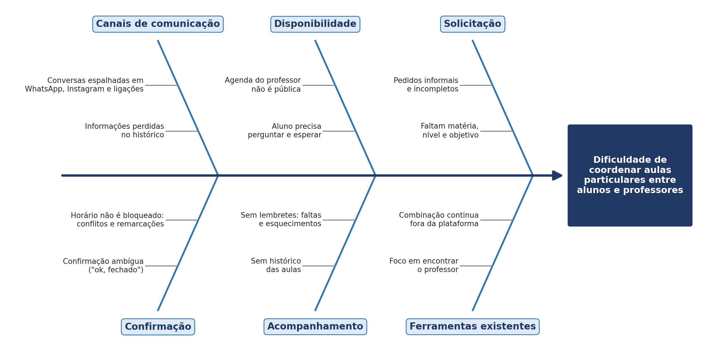
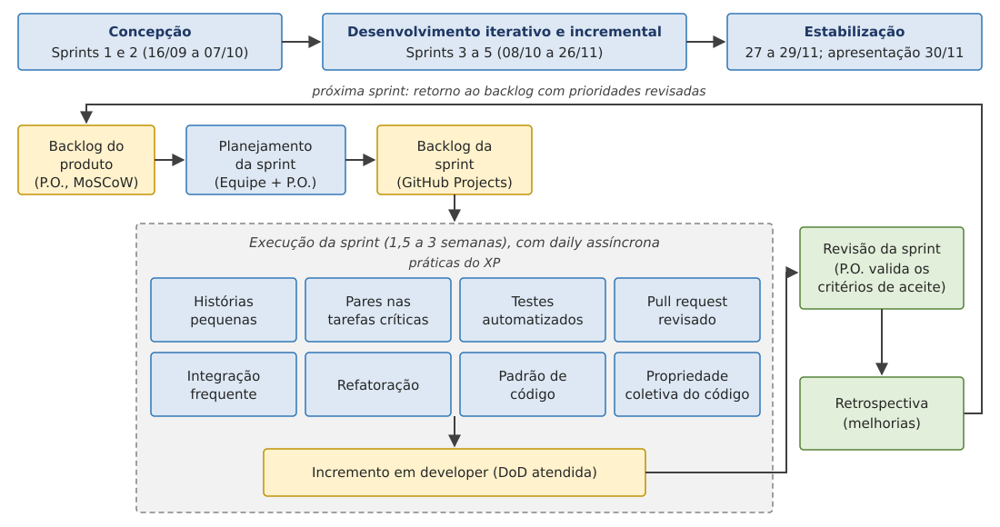
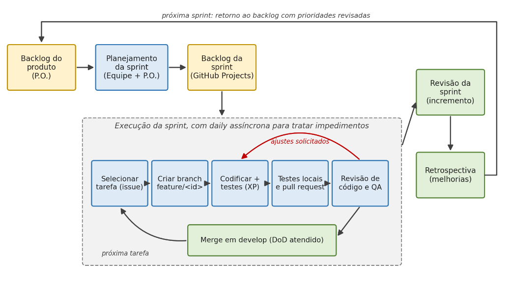

# Documento de Visão

[Baixar em PDF](../assets/pdf/T02_Hopper_Documento_de_Visao_1.1.pdf){ .md-button } Documento original da versão 1.1, nas normas ABNT.

AulaCerta – Grupo Hopper

Versão 1.1

**Tabela - Integrantes do Grupo:**

| Matrícula | Nome | Função (responsabilidade) | Pontos de participação na elaboração |
| --- | --- | --- | --- |
| **232036401** | Pedro França de Lima | Scrum Master, Product Owner e Developer | 12,5 |
| **251037617** | Matheus Ferraz de Queiroz | Developer | 12,5 |
| **251014793** | Pedro Henrique Caldas Alves | Developer | 12,5 |
| **251037125** | Juliana Pereira de Rocha | Developer | 12,5 |
| **251016724** | Yasmim Ayres dos Santos Guedes | Developer | 12,5 |
| **251019780** | Daniel Valle Rodrigues Maia | Developer | 12,5 |
| **251039513** | Felipe Lima Sant’Ana | Developer | 12,5 |
| **242005418** | Pedro Henrique Rodrigues Pereira | Developer | 12,5 |
| **Total de pontos** |  |  | 100 |

**Histórico de Revisões**

| **Data** | **Versão** | **Descrição** | **Autor** |
| --- | --- | --- | --- |
| **30/09/2026** | 1.0 | Versão inicial: visão do produto e do projeto, processo, escopo (backlog), métricas e testes. | Equipe |
| **14/11/2026** | 1.1 | Revisão após a avaliação do documento e o ponto de controle: TDD, teste de usabilidade (CT11, M1 a M3) e RNF01, RNF04 e RNF05 retirados, com a experiência do usuário mantida como diretriz de projeto; teste de aceitação substituído pela validação dos critérios de aceite pelo P.O.; Figura 2 substituída pelo ciclo de vida Scrum + XP; marcos com datas no Quadro 4 e percentuais atualizados; critério explícito de exposição dos riscos, com recálculo do Quadro 6 e novo risco R09 (planos gratuitos); métricas de negócio (G3: MN1 e MN2); RF20 (anotações), RF21 (avaliação) e RF22 (administração, cenário C07) retirados do escopo do semestre; ferramentas de teste e roteiro de testes atualizados conforme o código (Vitest, Supertest, React Testing Library e Playwright), com o registro das execuções no Quadro 21; hospedagem do front-end e da API no Render, no lugar da Vercel (Quadro 2). | Equipe |

Este documento registra a visão do produto AulaCerta e do projeto que o desenvolve, no contexto da disciplina FGA0312 – Métodos de Desenvolvimento de Software (UnB/FCTE, 2026/2). Ele reúne o problema tratado, a solução proposta, a organização e o planejamento do projeto, o processo de desenvolvimento, o escopo do produto, as métricas e a estratégia de testes.

## 1 VISÃO GERAL DO PRODUTO

### 1.1 Problema

**Contexto**

O problema proposto pela disciplina trata da coordenação entre clientes e prestadores de serviços em geral. A equipe escolheu as aulas particulares como recorte desse problema para desenvolver uma solução viável no prazo do semestre: alunos e professores precisam coordenar horários, pedidos, confirmações e acompanhamento de aulas, permitindo tratar as quatro etapas em um contexto específico. Esse recorte não pretende abranger todos os tipos de serviço. As aulas particulares, tratadas na literatura acadêmica como parte da chamada "educação-sombra" (BRAY, 2009), são uma atividade muito difundida no Brasil: apenas na categoria de reforço escolar, uma única plataforma lista mais de 158 mil professores no país (SUPERPROF, 2026b). Elas atendem desde alunos do ensino fundamental até universitários e candidatos a vestibulares, ao ENEM e a concursos. Do lado da oferta estão, em sua maioria, professores autônomos: estudantes universitários, professores da rede de ensino que complementam a renda e profissionais que ensinam uma habilidade específica, como idiomas ou música. Quando o aluno é menor de idade, os responsáveis também participam da contratação e do acompanhamento.

Na observação da equipe, é comum que a contratação aconteça por indicação e redes sociais e que a coordenação das aulas seja feita por canais informais: mensagens de WhatsApp, directs do Instagram, ligações e agendas de papel ou planilhas mantidas pelo próprio professor. O WhatsApp, em particular, é o aplicativo mais presente na tela inicial dos smartphones brasileiros, entre todos os aplicativos, aparecendo em 64,8% deles (MOBILE TIME, 2026). Plataformas especializadas, como o Superprof, ajudam a encontrar um professor, mas não resolvem a coordenação do dia a dia das aulas.

**Problema encontrado**

Alunos e professores enfrentam dificuldades para coordenar a disponibilidade, a solicitação, a confirmação e o acompanhamento das aulas particulares, sobretudo porque essas informações ficam espalhadas por canais dispersos. Cada etapa acontece em um lugar diferente e nenhum dos envolvidos tem a visão completa da situação.

Para o aluno (ou responsável), isso significa não saber quais professores atendem a matéria e o nível desejados nem quando eles estão livres, não ter certeza se a aula foi confirmada e perder o controle das aulas já realizadas e das próximas. Para o professor, significa responder repetidamente às mesmas perguntas, administrar a agenda de vários alunos por mensagens, lidar com remarcações e cancelamentos frequentes, correr o risco de marcar dois alunos no mesmo horário e perder pedidos no meio das conversas.

A Figura 1 apresenta o diagrama de Ishikawa (ISHIKAWA, 1986) elaborado pela equipe para organizar as causas desse problema em seis categorias.

**Figura 1 –** Diagrama de Ishikawa (espinha de peixe) do problema

**Fonte:** Elaborado pela equipe (2026).

As três primeiras categorias acompanham as etapas da coordenação. Em Disponibilidade, a agenda do professor não é pública, então o aluno precisa perguntar e esperar uma resposta. Em Solicitação, a causa é o pedido informal e incompleto; a falta de matéria, nível e objetivo da aula, que aparece na figura como item separado, é consequência desse pedido informal, e não uma causa independente. Em Confirmação, o acordo costuma ser um "ok, fechado" ambíguo, e o horário não fica bloqueado, o que gera conflitos e remarcações.

Em Acompanhamento, não existe histórico das aulas nem lembretes, o que favorece faltas e esquecimentos. A categoria Canais de comunicação reúne a causa transversal: as conversas se espalham por vários aplicativos e as informações se perdem no histórico. Por fim, em Ferramentas existentes, observa-se que as plataformas do setor focam em encontrar o professor; depois do primeiro contato, a combinação continua fora delas.

**Questão de pesquisa:** como facilitar a coordenação entre alunos e professores de aulas particulares quanto à disponibilidade, à solicitação, à confirmação e ao acompanhamento das aulas?

**Solução de software proposta**

A solução proposta é o AulaCerta, uma aplicação web responsiva de reserva de aulas particulares que centraliza as quatro etapas da coordenação em um único fluxo, com o status de cada aula visível para aluno e professor:

- **Disponibilidade:** o professor publica sua grade de horários livres, as matérias, os níveis e a modalidade de atendimento (online, presencial ou em domicílio), e o aluno vê apenas os horários realmente disponíveis.

- **Solicitação:** o aluno escolhe matéria, nível, modalidade e horário e descreve o objetivo da aula (prova, ENEM, reforço etc.) em um formulário estruturado.

- **Confirmação:** o professor aceita ou recusa o pedido; ao aceitar, o horário é bloqueado automaticamente e o aluno é notificado. Remarcações e cancelamentos também passam pela plataforma, com registro.

- **Acompanhamento:** cada aula tem um status (solicitada, confirmada, remarcada, cancelada, realizada) e fica registrada em um histórico, com lembretes antes do horário marcado.

A experiência do usuário (UX) é uma diretriz de projeto da solução, e não apenas um cuidado estético: a reserva de uma aula precisa ser simples o suficiente para competir com a troca de mensagens, pois, se o fluxo exigir esforço excessivo, há risco de os usuários preferirem os canais dispersos. Por isso, as telas são projetadas com poucos passos, status sempre visível, notificações e layout responsivo, tendo as heurísticas de Nielsen (NIELSEN, 1994) como referência. O projeto não prevê teste de usabilidade com alunos e professores reais; a facilidade de uso percebida por esse público permanece uma hipótese da equipe.

Espera-se, com isso, reduzir o tempo gasto para marcar e confirmar aulas, eliminar conflitos de horário, diminuir faltas e esquecimentos e dar a alunos, responsáveis e professores uma visão única e confiável das aulas. Assim, problema, causas e solução ficam alinhados: cada categoria do diagrama da Figura 1 é tratada por uma das etapas do fluxo proposto.

### 1.2 Declaração de Posição do Produto

O AulaCerta é uma aplicação web responsiva para a reserva e a coordenação de aulas particulares. Seus usuários-alvo são, de um lado, alunos (e seus responsáveis) que buscam aulas particulares, geralmente estudantes da educação básica, vestibulandos e universitários, e, de outro, professores autônomos que oferecem essas aulas e precisam organizar a agenda de vários alunos. Para ambos, o produto é importante porque substitui a troca de mensagens em vários canais por um fluxo único e rastreável.

O principal concorrente pesquisado é o Superprof, plataforma que conecta alunos e professores em mais de mil disciplinas. Nela, porém, o aluno precisa assinar o Passe Aluno para enviar pedidos de aula, e o pagamento das aulas é combinado entre aluno e professor, podendo ocorrer fora da plataforma (SUPERPROF, 2026a). Ou seja, o foco está em encontrar o professor, e boa parte da coordenação continua nos canais informais. O AulaCerta se diferencia por coordenar a aula do início ao fim: agenda, pedido, confirmação, remarcação e histórico no mesmo lugar, sem exigir pagamento prévio para o primeiro contato. O Quadro 1 resume a posição do produto.

**Quadro 1 –** Declaração de posição do produto

| Para: | Alunos (e responsáveis) que buscam aulas particulares e professores autônomos que as oferecem. |
| --- | --- |
| Necessidade: | Coordenar disponibilidade, solicitação, confirmação e acompanhamento das aulas em um único canal, sem depender de conversas espalhadas. |
| O AulaCerta: | é uma aplicação web responsiva de reserva de aulas particulares. |
| Que: | Centraliza agenda, pedidos, confirmações, remarcações e histórico das aulas, com status visível e notificações para aluno e professor. |
| Ao contrário: | Da coordenação por WhatsApp, ligações e redes sociais, em que as informações se perdem, e de plataformas como o Superprof, que focam em encontrar o professor e cobram assinatura para o primeiro contato. |
| Nosso produto: | Coordena a aula do início ao fim, em poucos passos e com foco em UX, sem barreira de pagamento para o primeiro contato. |

**Fonte:** Elaborado pela equipe (2026).

Em síntese, o Quadro 1 mostra que o valor do produto não está em ampliar a oferta de professores, mas em tornar a coordenação das aulas simples e confiável. Sem uma solução desse tipo, alunos e professores continuam dependendo de mensagens avulsas, com os conflitos de horário, as faltas e o retrabalho descritos na seção 1.1.

### 1.3 Objetivos do Produto

**Objetivo principal:** desenvolver uma aplicação web responsiva que centralize a coordenação de aulas particulares entre alunos e professores, cobrindo disponibilidade, solicitação, confirmação e acompanhamento das aulas, tendo a experiência do usuário como diretriz de projeto.

**Objetivos secundários:**

- permitir que o professor mantenha um perfil com matérias, níveis, modalidades e valor da hora-aula, e publique sua disponibilidade semanal;

- permitir que o aluno encontre professores por matéria, nível e modalidade e solicite uma aula informando o objetivo;

- garantir a confirmação ou recusa dos pedidos com bloqueio automático do horário, impedindo conflitos de agenda;

- registrar remarcações e cancelamentos na própria plataforma;

- oferecer acompanhamento por status, histórico de aulas, notificações e lembretes;

- medir se os pedidos de aula se convertem em aulas confirmadas e em quanto tempo isso acontece (métricas de negócio MN1 e MN2).

O objetivo principal responde diretamente à questão de pesquisa da seção 1.1. Os objetivos intermediários correspondem às etapas do fluxo de coordenação e, portanto, às categorias do diagrama de Ishikawa. O último objetivo liga o produto ao negócio: ele é acompanhado pelas métricas de negócio da seção 5.

### 1.4 Tecnologias a Serem Utilizadas

A escolha das tecnologias considerou três critérios: aderência ao problema (uma aplicação web responsiva, acessível pelo celular), familiaridade ou facilidade de aprendizado pela equipe no prazo do semestre e disponibilidade de ferramentas gratuitas. O Quadro 2 apresenta as tecnologias adotadas. O detalhamento de como elas se organizam na solução é tratado no Documento de Arquitetura.

**Quadro 2 –** Tecnologias adotadas no projeto

| **Categoria** | **Tecnologia** | **Justificativa** |
|----|----|----|
| Front-end | React com TypeScript (Vite) | Componentização da interface, tipagem que reduz defeitos e ampla documentação. |
| Estilo e interface | Tailwind CSS | Agiliza a construção de telas responsivas e consistentes. |
| Back-end | Node.js com Express (TypeScript) | Mesma linguagem no front-end e no back-end, o que facilita a colaboração na equipe. |
| Banco de dados e acesso | PostgreSQL com Prisma ORM | Banco relacional adequado a agendas e reservas; o ORM simplifica migrações e consultas. |
| Autenticação e segurança | JWT e bcrypt | Sessões sem estado e armazenamento seguro de senhas. |
| Notificações | Notificações na aplicação; e-mail apenas para recuperação de senha, pela API HTTP do Brevo | Avisos de solicitação, confirmação e recusa exibidos na aplicação; link de redefinição de senha por e-mail (RF03). A API HTTP é usada porque a hospedagem gratuita bloqueia as portas SMTP (risco R09). |
| Testes | Vitest e Supertest (back-end); Vitest e React Testing Library (front-end); Playwright (sistema) | Cobrem os níveis unitário, de integração e de sistema (ponta a ponta). Front-end e back-end usam a mesma ferramenta de testes, o Vitest. |
| UX | Heurísticas de Nielsen como diretriz de projeto | Orientam o projeto das telas e dos fluxos; não há teste de usabilidade previsto. |
| Versionamento e gestão | Git, GitHub e GitHub Projects | Repositório, revisão por pull requests e quadro Kanban das sprints. |
| Ambiente e implantação | Docker; hospedagem gratuita no Render (front-end e API) e no Neon (banco de dados) | Ambiente padronizado para a equipe e publicação da versão do software. |
| Métodos e técnicas | Scrum, XP, histórias de usuário, MoSCoW, heurísticas de Nielsen | Base do processo descrito nas seções 2.1 e 3. |
| Comunicação | Microsoft Teams e WhatsApp | Canais já usados pela turma, pelo professor e pelos monitores. |

**Fonte:** Elaborado pela equipe (2026).

## 2 VISÃO GERAL DO PROJETO

### 2.1 Ciclo de vida do projeto de desenvolvimento de software

O projeto segue um ciclo de vida iterativo e incremental que combina os eventos e artefatos do Scrum com práticas do XP, apresentado na Figura 2. O projeto tem três fases: concepção (Sprints 1 e 2), desenvolvimento iterativo e incremental (Sprints 3 a 5) e estabilização antes da apresentação. Na fase de desenvolvimento, cada sprint repete o mesmo ciclo: o P.O. prioriza o backlog do produto, a equipe planeja a sprint e forma o backlog da sprint, desenvolve com as práticas do XP e acompanhamento diário, e entrega um incremento, que o P.O. valida na revisão; a retrospectiva gera melhorias para a sprint seguinte, e os itens não aceitos voltam ao backlog do produto.

**Figura 2 –** Ciclo de vida Scrum + XP do projeto AulaCerta

**Fonte:** Elaborado pela equipe (2026), com base nos ciclos do Scrum e do XP apresentados na disciplina.

O ciclo da Figura 2 é instanciado para o AulaCerta da seguinte forma:

**Metodologia:** ágil. O semestre oferece cerca de sete semanas de desenvolvimento, e o backlog poderá ser refinado conforme a equipe examina os incrementos. Uma abordagem ágil permite entregar valor cedo, verificar internamente os fluxos e ajustar o rumo a cada ciclo (PRESSMAN; MAXIM, 2016).

**Processo:** Scrum combinado com práticas do XP, em um ciclo de vida iterativo e incremental (SCHWABER; SUTHERLAND, 2020; BECK, 2004). As duas primeiras sprints seguem o calendário da disciplina e são dedicadas à concepção (Documentos de Visão e de Arquitetura). Após a reunião de 02/10/2026, que definiu a arquitetura, e a entrega do respectivo documento em 07/10/2026, o desenvolvimento começou em 08/10/2026. As três sprints seguintes duram de uma semana e meia a três semanas e terminam com um incremento funcionando.

**Procedimentos:** planejamento, daily assíncrona, revisão e retrospectiva de cada sprint; toda alteração de código entra por pull request revisado; as histórias só entram na sprint quando atendem à Definição de Preparado (DoR) e só são encerradas quando atendem à Definição de Pronto (DoD), descritas na seção 3.

**Métodos:** histórias de usuário (COHN, 2004), priorização MoSCoW, estimativa por planning poker, testes automatizados unitários e de integração escritos junto com o código das regras de agendamento, programação em pares nas tarefas críticas e heurísticas de Nielsen (NIELSEN, 1994) como diretriz de projeto da interface.

**Ferramentas:** GitHub e GitHub Projects para código e gestão, VS Code como ambiente de desenvolvimento e Microsoft Teams para comunicação, conforme o Quadro 2.

### 2.2 Organização do Projeto

O Quadro 3 apresenta a divisão de atribuições e responsabilidades entre os membros do projeto, sem qualquer relação de hierarquia ou grau de importância: todos os integrantes são igualmente responsáveis pelo sucesso do projeto. Seguindo o princípio de propriedade coletiva do código do XP, todos os membros também desenvolvem; o papel indica a responsabilidade principal de cada um. No Quadro 3, os integrantes são identificados por nome e sobrenome; seus nomes completos e matrículas constam na tabela de integrantes do grupo.

**Quadro 3 –** Organização do projeto: papéis e responsabilidades

| **Papel** | **Atribuições** | **Responsável** | **Participantes** |
|----|----|----|----|
| Scrum Master | Facilitar as cerimônias, remover impedimentos, manter o quadro do GitHub Projects, as atas e o relatório de situação, acompanhar os riscos. | Pedro França | Toda a equipe |
| Product Owner (P.O.) | Manter e priorizar o backlog, escrever e refinar histórias e critérios de aceite, validar as entregas nas revisões de sprint. | Pedro França | Toda a equipe |
| Designer UX/UI | Aplicar as diretrizes de UX aos fluxos e revisar a consistência visual da interface. | Pedro Caldas | Felipe Lima |
| Desenvolvedor front-end | Implementar as telas responsivas em React, integrá-las à API e escrever testes de componentes. | Pedro Caldas | Felipe Lima |
| Desenvolvedor back-end | Modelar os dados, implementar a API e as regras de agendamento, escrever testes unitários e de integração, cuidar da implantação. | Matheus Ferraz | Daniel Valle |
| Desenvolvedor de banco de dados | Modelar o banco relacional, manter migrações, consultas e integridade dos dados de agenda e reservas. | Juliana Pereira | Yasmim Ayres |
| Analista de Qualidade | Definir a estratégia e o roteiro de testes, revisar pull requests, verificar a DoD, registrar defeitos e coletar as métricas. | Pedro Rodrigues | Yasmim Ayres |
| Cliente potencial | Os clientes potenciais do AulaCerta são alunos, responsáveis e professores particulares. Neste projeto acadêmico, o P.O. da equipe representa suas necessidades como hipóteses; o professor e os monitores acompanham e avaliam o projeto. | Pedro França (P.O.; representação interna) | Equipe do projeto |

**Fonte:** Elaborado pela equipe (2026).

### 2.3 Planejamento das Fases e/ou Iterações do Projeto

O Quadro 4 registra as fases e iterações do projeto, com datas alinhadas ao cronograma da disciplina e à reunião de definição da arquitetura em 02/10/2026: entrega do Documento de Visão em 30/09/2026, Documento de Arquitetura em 07/10/2026 e início do desenvolvimento em 08/10/2026. Os eventos críticos aparecem no próprio quadro como marcos, com suas datas: a entrega da release no ponto de controle (11/11/2026), a inspeção (16/11/2026), os reparos da inspeção (16 a 26/11/2026) e a apresentação do software rodando (30/11/2026). A Sprint 5 termina em 26/11/2026; o período de 27 a 29/11/2026 fica reservado para estabilização, ensaio e contingências antes da apresentação, sem previsão de novas funcionalidades. O percentual de conclusão é atualizado ao fim de cada sprint, em intervalos de 10%, e essa atualização é auditada pelos monitores no repositório da equipe.

**Quadro 4 –** Planejamento das sprints do projeto

| **Sprint** | **Produto (Entrega)** | **Data Início** | **Data Fim** | **Entregável(eis)** | **Responsáveis** | **% conclusão** |
|----|----|----|----|:--:|----|----|
| Sprint 1 | Definição do produto | 16/09/2026 | 30/09/2026 | DV, BKL | P.O., Scrum Master, UX e equipe | 100% |
| Sprint 2 | Definição e documentação da arquitetura | 01/10/2026 | 07/10/2026 | DA | Desenvolvedores, UX e Scrum Master | 100% |
| Sprint 3 | Preparação do ambiente; cadastro, autenticação, perfil e disponibilidade (C01, C02) | 08/10/2026 | 25/10/2026 | AMB, APR, INC1 | Desenvolvedores, QA e P.O. | 100% |
| Sprint 4 | Busca, solicitação e confirmação de aulas (C03, C04) | 26/10/2026 | 15/11/2026 | INC2, PC | Desenvolvedores, QA e P.O. | 100% |
| **Marco** | **Ponto de controle: entrega e apresentação da release (INC2)** | **11/11/2026** | **11/11/2026** | **PC** | Toda a equipe | 100% |
| **Marco** | **Inspeção do produto** | **16/11/2026** | **16/11/2026** | — | Professor, monitores e equipe | — |
| **Marco** | **Reparos da inspeção, dentro da Sprint 5** | **16/11/2026** | **26/11/2026** | **RINSP** | Toda a equipe | 0% |
| Sprint 5 | Remarcação, cancelamento e acompanhamento (C05, C06) | 16/11/2026 | 26/11/2026 | INC3, RT | Toda a equipe | 20% |
| Estabilização | Correções finais, ensaio e contingências, sem novas funcionalidades | 27/11/2026 | 29/11/2026 | — | Toda a equipe | 0% |
| **Marco** | **Apresentação com o software rodando** | **30/11/2026** | **30/11/2026** | **APF** | Toda a equipe | 0% |

**Fonte:** Elaborado pela equipe (2026).

Situação em 14/11/2026, conferida no código do repositório: as Sprints 1 a 4 estão concluídas, incluindo RF10 (aulas recorrentes) e RF13 (notificações na aplicação) no back-end e no front-end. Na Sprint 5, o RF17 está parcial (o selo de status aparece nas aulas, mas nenhuma aula passa sozinha a "realizada") e o RF18 também (a lista de aulas tem a aba Histórico, ainda sem filtros); os demais requisitos da Sprint 5 (RF15, RF16 e RF19) não foram iniciados.

**Legenda dos entregáveis (aliases):**

- **DV:** Documento de Visão do Produto e do Projeto (este documento).

- **BKL:** backlog inicial priorizado, registrado no GitHub Projects.

- **DA:** Documento de Arquitetura.

- **AMB:** repositório e ambientes configurados.

- **APR:** apresentações do DV (14/10/2026) e do DA (19/10/2026).

- **INC1, INC2, INC3:** incrementos de software funcionando, integrados na branch developer ao fim de cada sprint; a versão estável é publicada na branch main antes da apresentação final.

- **PC:** entrega e apresentação da release no ponto de controle de 11/11/2026.

- **RINSP:** correção dos defeitos apontados na inspeção de 16/11/2026, feita durante a Sprint 5.

- **RT:** relatório de testes, com o roteiro de previsto x realizado (Quadro 21).

- **APF:** apresentação da equipe com o software rodando em 30/11/2026.

### 2.4 Matriz de Comunicação

O Quadro 5 descreve a estratégia de comunicação adotada para monitorar o progresso do projeto: as reuniões previstas, sua periodicidade, os envolvidos e os produtos gerados. As atas e os relatórios de situação ficam na pasta de documentação do repositório.

**Quadro 5 –** Matriz de comunicação

| **Descrição** | **Área / Envolvidos** | **Periodicidade** | **Produtos gerados** |
|----|----|----|----|
| Daily: andamento das tarefas e impedimentos | Equipe do projeto | Dias úteis (assíncrona, no Teams) | Registro no canal da equipe; quadro atualizado |
| Planejamento da sprint | Equipe e P.O. | Início de cada sprint | Backlog da sprint no GitHub Projects |
| Acompanhamento das atividades, riscos, compromissos, ações pendentes e indicadores | Equipe do projeto | Semanal | Ata de reunião; relatório de situação do projeto |
| Revisão da sprint: demonstração do incremento e validação dos critérios de aceite | Equipe e P.O. | Fim de cada sprint | Incremento validado; ata de revisão |
| Retrospectiva | Equipe do projeto | Fim de cada sprint | Lista de ações de melhoria |
| Comunicar a situação do projeto | Equipe, professor e monitor | Semanal e nos marcos avaliativos | Relatório de situação; apresentações |
| Execução e registro dos testes | Desenvolvedores e Analista de Qualidade | Antes de cada pull request e ao fim de cada sprint | Log e relatório HTML de cada execução; roteiro da seção 6.2 atualizado |

**Fonte:** Elaborado pela equipe (2026).

### 2.5 Gerenciamento de Riscos

O Quadro 6 reúne os riscos identificados no projeto. A exposição é calculada por um critério explícito: probabilidade (P) e impacto (I) recebem pesos de 1 a 3 (baixa ou baixo = 1; média ou médio = 2; alta ou alto = 3), a pontuação é o produto P × I e a exposição segue a faixa da pontuação: de 1 a 2, baixa; de 3 a 4, média; de 6 a 9, alta. Assim, riscos com combinações diferentes podem ter a mesma exposição, mas não a mesma pontuação: R01 (alta × alto = 9) e R04 (média × alto = 6) são ambos de exposição alta, assim como R03 (alta × alto = 9) e R05 (média × alto = 6), e a pontuação indica que R01 e R03 têm prioridade; já R02 (alta × médio = 6) tem exposição alta, enquanto R07 e R08 (média × médio = 4) têm exposição média. Riscos de exposição alta recebem plano de mitigação, para evitar que ocorram, e todos têm plano de contingência, acionado caso ocorram[^1]. A lista é revisada semanalmente na reunião de acompanhamento, e os riscos são registrados no quadro do projeto no GitHub.

**Quadro 6 –** Riscos do projeto

| **ID** | **Risco** | **Prob.** | **Impacto** | **P × I** | **Exposição** | **Plano de mitigação** | **Plano de contingência** |
|----|----|----|----|----|----|----|----|
| R01 | Curva de adoção das tecnologias escolhidas (React, Node.js e Prisma) | Alta | Alto | 9 | Alta | Estudos dirigidos e provas de conceito na Sprint 3; programação em pares. | Reduzir o escopo às histórias Must; simplificar a arquitetura. |
| R02 | Indisponibilidade de membros (provas, outras disciplinas) | Alta | Médio | 6 | Alta | Tarefas pequenas e visíveis no quadro; conhecimento compartilhado por revisão de código. | Redistribuir tarefas e replanejar a sprint. |
| R03 | Escopo maior que o tempo de desenvolvimento (cerca de sete semanas) | Alta | Alto | 9 | Alta | Priorização MoSCoW; MVP formado apenas pelas histórias Must. | Mover itens Should e Could para versões futuras (aplicada: anotações, avaliação e administração ficaram fora do escopo do semestre). |
| R04 | Falhas na regra de agendamento (reserva dupla, horários sobrepostos) | Média | Alto | 6 | Alta | Validação no back-end, dentro de transação; testes unitários e de integração dessa regra (CT05). | Priorizar a correção; exigir confirmação manual até corrigir. |
| R05 | Fluxo trabalhoso leva o usuário a preferir o WhatsApp | Média | Alto | 6 | Alta | Diretrizes de UX no projeto das telas (poucos passos, status visível, notificações); validação dos critérios de aceite pelo P.O. em cada revisão. | Simplificar o fluxo crítico na sprint seguinte. |
| R07 | Conflitos de merge ou perda de código | Média | Médio | 4 | Média | Política de branches e pull requests revisados. | Reverter pelo histórico do Git. |
| R08 | Interrupções no calendário acadêmico (feriados, eventos, cancelamentos de aula) | Média | Médio | 4 | Média | Folga no planejamento das sprints. | Aplicar os critérios de replanejamento (seção 2.6). |
| R09 | Limitações dos planos gratuitos de hospedagem e serviços (materializado em 09/11/2026: o Render bloqueia as portas SMTP, e o e-mail de recuperação de senha não saía) | Alta | Médio | 6 | Alta | Conferir os limites do plano gratuito antes de adotar um serviço; preferir serviços acessados por API HTTP. | Trocar de provedor ou de forma de acesso: o envio de e-mail passou do SMTP para a API HTTP do Brevo. |

**Fonte:** Elaborado pela equipe (2026).

A numeração dos riscos não é contínua porque riscos retirados em revisões anteriores mantiveram seus números, para rastreabilidade (ver o Histórico de Revisões).

### 2.6 Critérios de Replanejamento

Os critérios do Quadro 7 indicam quando o planejamento deve ser revisto. Muitos deles derivam dos riscos da seção 2.5 e estão alinhados aos respectivos planos de mitigação e contingência. Os critérios são verificados a cada revisão de sprint, e todo replanejamento gera uma nova versão deste documento, registrada no Histórico de Revisões.

**Quadro 7 –** Critérios de replanejamento

| **Critério** | **Gatilho** | **Ação de replanejamento** |
|----|----|----|
| Desempenho da sprint | Menos de 70% dos pontos planejados concluídos | Rever a capacidade e reduzir o escopo da sprint seguinte. |
| Risco materializado | Ocorrência de risco de exposição alta (R01 a R05 e R09) | Acionar a contingência do Quadro 6 e replanejar as sprints afetadas. |
| Mudança de prioridade | O P.O. reprioriza o backlog ou não aceita uma história na revisão da sprint por não atender aos critérios de aceite | Reordenar o backlog e incluir o ajuste na próxima sprint. |
| Qualidade | Defeitos críticos abertos ao fim da sprint ou apontados na inspeção de 16/11/2026 | Reservar capacidade da sprint seguinte para correções antes de novas histórias. |
| Equipe | Saída ou afastamento prolongado de um integrante | Redistribuir papéis e tarefas e revisar o escopo. |
| Calendário | Alteração no cronograma da disciplina | Ajustar datas e entregáveis do Quadro 4. |

**Fonte:** Elaborado pela equipe (2026).

## 3 PROCESSO DE DESENVOLVIMENTO DE SOFTWARE

O processo adotado é uma adaptação do Scrum com práticas do XP, coerente com o ciclo de vida da seção 2.1. Esta seção não pretende ser prescritiva nem detalhista: ela serve de guia para a equipe. A Figura 3 ilustra o fluxo de trabalho.

**Figura 3 –** Fluxo de trabalho do processo de desenvolvimento

**Fonte:** Elaborado pela equipe (2026).

A cada sprint, o P.O. traz as histórias priorizadas do backlog do produto, e a equipe seleciona as que cabem na sua capacidade, formando o backlog da sprint. Durante a execução, cada desenvolvedor seleciona uma tarefa, cria uma branch, implementa o código com seus testes, executa os testes localmente e abre um pull request, que é revisado; se houver ajustes, a tarefa volta à codificação. Aprovado, o código é integrado à branch developer. Ao fim da sprint, o incremento é demonstrado na revisão e a equipe faz a retrospectiva, cujas melhorias alimentam a sprint seguinte. O Quadro 8 detalha as atividades, com entradas, saídas e responsáveis.

**Quadro 8 –** Atividades do processo de desenvolvimento

| **Atividade** | **Entrada** | **Saída** | **Responsável (papel)** |
|----|----|----|----|
| Refinamento do backlog | Backlog do produto; itens devolvidos na revisão | Histórias com critérios de aceite, estimadas e priorizadas | P.O. (com a equipe) |
| Planejamento da sprint | Histórias que atendem à DoR; capacidade da equipe | Meta e backlog da sprint | Equipe, P.O. e Scrum Master |
| Planejamento de UX | Histórias da sprint | Diretrizes de UX e regras de interação registradas nas histórias | Designer UX/UI |
| Desenvolvimento | Tarefa (issue) do backlog da sprint | Código e testes em uma branch própria | Desenvolvedores |
| Revisão de código e QA | Pull request com os testes executados e aprovados pelo autor | Pull request aprovado ou ajustes solicitados | Analista de Qualidade e um desenvolvedor revisor |
| Integração | Pull request aprovado | Merge em developer; história atende à DoD | Autor do pull request |
| Revisão da sprint | Incremento integrado em developer | Incremento aceito pelo P.O. ou itens devolvidos ao backlog | Equipe e P.O. |
| Retrospectiva | Resultados e métricas da sprint | Ações de melhoria para a próxima sprint | Equipe, facilitada pelo Scrum Master |

**Fonte:** Elaborado pela equipe (2026).

**Política de branches e commits**

- **main:** versão estável, atualizada a partir de developer somente quando o incremento está pronto para publicação; a versão final é publicada antes da apresentação de 30/11/2026.

- **developer:** branch de integração, que recebe os pull requests aprovados.

- **`feature/<descricao>`:** uma branch por história ou tarefa, criada a partir de developer; correções usam `fix/<descricao>` e trabalhos só de testes usam `test/<descricao>`.

- **Commits:** mensagens no padrão Conventional Commits (ex.: feat: solicitar aula), referenciando o requisito ou a issue quando houver (ex.: RF12).

**Definição de Preparado (DoR)**

Uma história só entra na sprint quando tem descrição no formato de história de usuário, critérios de aceite, estimativa em pontos e nenhuma dependência bloqueante.

**Definição de Pronto (DoD)**

Uma história só é considerada pronta quando todos os critérios de aceite foram atendidos, o código foi revisado e integrado em developer, os testes automatizados passam, a cobertura das regras de negócio se mantém acima de 70%, a interface funciona em celular e em computador, não há defeitos críticos abertos e o P.O. validou os critérios de aceite da história.

## 4 DECLARAÇÃO DE ESCOPO DO PROJETO

### 4.1 Backlog do produto

O backlog do produto está organizado por perfis (seção 4.2), cenários (seção 4.3) e requisitos associados a histórias de usuário (seção 4.4). A prioridade de cada requisito segue a técnica MoSCoW, e o Quadro 9 define o que cada classe representa para o AulaCerta. Essa classificação é a visão da equipe e é validada pelo P.O.

**Quadro 9 –** Classes de priorização MoSCoW para o AulaCerta

| **Classe** | **Significado para o produto** |
|----|----|
| Must (obrigatório) | Sem o requisito, o fluxo de coordenação (disponibilidade, solicitação, confirmação e acompanhamento) não funciona ou não resolve o problema. Compõe o MVP. |
| Should (importante) | Melhora significativamente a experiência ou reduz esforço, mas existe alternativa manual temporária. Entra se houver capacidade nas sprints. |
| Could (desejável) | Agrega valor, mas não é essencial para validar a solução. Fica para o fim do projeto ou para versões futuras. |
| Won't (fora do escopo) | Não será tratado neste semestre: pagamento dentro da plataforma, videochamada integrada, aplicativo móvel nativo, anotações da aula, avaliação de aulas e administração da plataforma. |

**Fonte:** Elaborado pela equipe (2026).

Os requisitos foram formulados pela equipe com brainstorming e benchmarking na concepção. O Quadro 10 apresenta essas fontes e a revisão interna feita a cada incremento. As necessidades atribuídas ao público-alvo são hipóteses da equipe.

**Quadro 10 –** Técnicas de elicitação de requisitos

| **Técnica** | **Finalidade** | **Responsável** |
|----|----|----|
| Brainstorming | Levantar ideias iniciais e causas do problema (base do diagrama de Ishikawa) | Equipe |
| Benchmarking | Analisar concorrentes como o Superprof e agendas genéricas, identificando lacunas | Equipe |
| Análise de cenários pela equipe | Identificar hipóteses sobre necessidades de alunos e responsáveis sem pesquisa de campo | Equipe e P.O. |
| Revisão de regras de negócio | Verificar coerência entre agenda, remarcações, cancelamentos e critérios de aceite | Equipe e P.O. |
| Validação dos critérios de aceite | Verificar, na revisão de cada sprint, se cada história atende aos seus critérios de aceite e orientar ajustes nas sprints seguintes | P.O. e equipe |

**Fonte:** Elaborado pela equipe (2026).

### 4.2 Perfis

O Quadro 11 identifica os perfis de acesso ao AulaCerta, suas características e permissões. As limitações de cada perfil são tratadas nas regras de autorização descritas no Documento de Arquitetura.

**Quadro 11 –** Perfis de acesso

| **\#** | **Nome do perfil** | **Características do perfil** | **Permissões de acesso** |
|----|----|----|----|
| 1 | Visitante | Pessoa não autenticada que conhece a plataforma. | Buscar professores, ver perfis e horários livres, cadastrar-se. |
| 2 | Aluno | Estudante que busca aulas; inclui o responsável que age em nome de um aluno menor de idade. | Manter o próprio perfil; solicitar, remarcar e cancelar aulas; acompanhar status e histórico. |
| 3 | Professor | Profissional autônomo que oferece aulas particulares. | Manter perfil e disponibilidade; aceitar ou recusar pedidos; remarcar e cancelar aulas; ver histórico. |
| 4 | Administrador | Membro da equipe responsável pela operação da plataforma. | Perfil previsto no modelo de dados, sem funções próprias neste semestre: a administração da plataforma está fora do escopo (Quadro 9). |

**Fonte:** Elaborado pela equipe (2026).

Como os perfis têm características distintas, a equipe usa técnicas de elicitação diferentes para cada um, conforme o Quadro 12.

**Quadro 12 –** Técnicas de elicitação por perfil

| **Perfil** | **Técnica(s)** | **Justificativa** |
|----|----|----|
| Aluno | Análise interna de cenários e validação dos critérios de aceite | A equipe examina cenários de reserva do aluno e o P.O. valida os critérios de aceite nas revisões, sem inferir a experiência de usuários reais. |
| Professor | Revisão interna das regras de agenda | A agenda com vários alunos e remarcações exige cenários e critérios de aceite específicos, revisados pela equipe. |
| Administrador | Brainstorming da equipe | Perfil interno, cujas necessidades são conhecidas pela própria equipe. |
| Visitante | Benchmarking e análise de cenários | A equipe compara o fluxo inicial com alternativas disponíveis, sem afirmar avaliação por visitantes reais. |

**Fonte:** Elaborado pela equipe (2026).

### 4.3 Cenários

Os cenários funcionais agrupam os requisitos segundo as etapas do fluxo de coordenação. O Quadro 13 lista os cenários e as sprints em que são desenvolvidos.

**Quadro 13 –** Cenários funcionais

| **Sistema: AulaCerta – Cenários funcionais** |  |  |
| --- | --- | --- |
| **Numeração do cenário** | **Nome do cenário** | **Sprints** |
| C01 | Cadastro e autenticação de usuários | Sprint 3 |
| C02 | Perfil e disponibilidade do professor | Sprint 3 |
| C03 | Busca de professores e solicitação de aula | Sprint 4 |
| C04 | Confirmação ou recusa de aula | Sprint 4 |
| C05 | Remarcação e cancelamento de aula | Sprint 5 |
| C06 | Acompanhamento das aulas (status, histórico, notificações e lembretes) | Sprint 5 |

**Fonte:** Elaborado pela equipe (2026).

Os cenários C02 a C06 correspondem diretamente às quatro etapas da questão de pesquisa: disponibilidade (C02), solicitação (C03), confirmação (C04) e acompanhamento (C06); a remarcação e o cancelamento (C05) completam o fluxo. C01 dá suporte ao fluxo principal.

### 4.4 Tabela de Backlog do produto

O Quadro 14 apresenta o backlog do produto. A numeração associa cada requisito ao seu cenário (Quadro 13); os requisitos não funcionais valem para todas as sprints. Ao todo, são 18 requisitos funcionais (13 Must, 4 Should e 1 Could) e 3 requisitos não funcionais, todos comprovados por testes (seção 6). A numeração não é contínua porque requisitos retirados em revisões anteriores mantiveram seus números, para rastreabilidade (ver o Histórico de Revisões).

Na Sprint 5, os itens Must são cancelar (RF16) e remarcar (RF15), e os itens Should são lembretes (RF19) e histórico com filtros (RF18), além da conclusão do acompanhamento de status (RF17).

**Quadro 14 –** Backlog do produto

| **Sistema: AulaCerta – Backlog do produto** |  |  |  |  |  |  |
| --- | --- | --- | --- | --- | --- | --- |
| **Numeração**  **(Cenário / requisito)** | **Sprint** | **Nome do requisito** | **Tipo de requisito**  **(Funcional / não funcional)** | **Priorização do requisito**  **Must, Should, Could** | **Descrição sucinta do requisito** | **Histórias de usuário (U.S.) associadas** |
| C01-RF01 | Sprint 3 | Cadastrar usuário | Funcional | Must | Cadastro como aluno ou professor, com nome, e-mail, senha e telefone. | US01 – Como visitante, quero me cadastrar como aluno ou professor, para usar a plataforma. |
| C01-RF02 | Sprint 3 | Autenticar usuário | Funcional | Must | Entrar e sair da plataforma com e-mail e senha. | US02 – Como usuário, quero entrar com meu e-mail e senha, para acessar minhas aulas. |
| C01-RF03 | Sprint 3 | Recuperar senha | Funcional | Should | Redefinir a senha por link enviado ao e-mail. | US03 – Como usuário, quero recuperar minha senha, para voltar a acessar minha conta. |
| C02-RF04 | Sprint 3 | Manter perfil do professor | Funcional | Must | Matérias, níveis, modalidades (online, presencial, domicílio), valor da hora-aula e apresentação. | US04 – Como professor, quero descrever o que ensino e como atendo, para receber pedidos adequados. |
| C02-RF05 | Sprint 3 | Publicar disponibilidade | Funcional | Must | Grade semanal de horários livres. | US05 – Como professor, quero publicar meus horários livres, para não precisar informá-los a cada aluno. |
| C02-RF06 | Sprint 3 | Bloquear horários pontuais | Funcional | Should | Exceções na grade (feriados, compromissos). | US06 – Como professor, quero bloquear um horário específico, para evitar pedidos quando não posso atender. |
| C03-RF07 | Sprint 4 | Buscar professores | Funcional | Must | Filtros por matéria, nível e modalidade. | US07 – Como aluno, quero buscar professores por matéria, nível e modalidade, para encontrar quem atende minha necessidade. |
| C03-RF08 | Sprint 4 | Visualizar perfil e horários livres | Funcional | Must | Perfil do professor com os horários realmente disponíveis. | US08 – Como aluno, quero ver os horários livres do professor, para escolher um sem precisar perguntar. |
| C03-RF09 | Sprint 4 | Solicitar aula | Funcional | Must | Pedido com matéria, nível, modalidade, horário e objetivo. | US09 – Como aluno, quero solicitar uma aula informando meu objetivo, para que o professor tenha o que precisa para aceitar. |
| C03-RF10 | Sprint 4 | Solicitar aulas recorrentes | Funcional | Could | Pedido de aula semanal em um mesmo horário. | US10 – Como aluno, quero marcar aulas semanais de uma vez, para não repetir o pedido toda semana. |
| C04-RF11 | Sprint 4 | Aceitar ou recusar solicitação | Funcional | Must | Decisão do professor sobre cada pedido, com motivo opcional na recusa. | US11 – Como professor, quero aceitar ou recusar pedidos, para controlar minha agenda. |
| C04-RF12 | Sprint 4 | Bloquear horário e impedir conflito | Funcional | Must | Ao aceitar, o horário é bloqueado; pedidos e aceites sobrepostos são impedidos. | US12 – Como professor, quero que um horário aceito fique bloqueado, para nunca marcar dois alunos juntos. |
| C04-RF13 | Sprint 4 | Notificar na plataforma | Funcional | Must | Aviso ao aluno e ao professor a cada mudança de status. | US13 – Como aluno, quero ser avisado quando o professor responder, para saber se a aula está confirmada. |
| C05-RF15 | Sprint 5 | Remarcar aula | Funcional | Must | Proposta de novo horário, que precisa ser aceita pela outra parte. | US15 – Como aluno ou professor, quero propor um novo horário, para remarcar sem trocar mensagens. |
| C05-RF16 | Sprint 5 | Cancelar aula | Funcional | Must | Cancelamento com registro do motivo e liberação do horário. | US16 – Como aluno ou professor, quero cancelar uma aula informando o motivo, para que o horário seja liberado. |
| C06-RF17 | Sprint 5 | Acompanhar status da aula | Funcional | Must | Status: solicitada, confirmada, recusada, remarcada, cancelada, realizada. | US17 – Como aluno, quero ver o status das minhas aulas, para saber sempre em que pé estão. |
| C06-RF18 | Sprint 5 | Consultar histórico de aulas | Funcional | Should | Lista das aulas passadas e futuras, com filtros. | US18 – Como aluno ou responsável, quero consultar o histórico, para acompanhar a frequência das aulas. |
| C06-RF19 | Sprint 5 | Enviar lembrete | Funcional | Should | Lembrete exibido na aplicação para as aulas confirmadas nas próximas 24 h. | US19 – Como aluno ou professor, quero receber um lembrete, para não esquecer a aula. |
| RNF02 | Todas | Responsividade | Não funcional | Must | Funcionar em telas a partir de 360 px de largura e em computadores, sem rolagem horizontal. | Todas as histórias com interface. |
| RNF03 | Todas | Segurança | Não funcional | Must | Senhas com hash (bcrypt), autenticação por JWT e HTTPS. | US01, US02, US03 |
| RNF06 | Todas | Privacidade | Não funcional | Should | Coleta mínima de dados e consentimento, conforme a LGPD (BRASIL, 2018); contato do outro participante liberado somente após a confirmação da aula. | US01, US04, US11 |

**Fonte:** Elaborado pela equipe (2026).

## 5 MÉTRICAS E MEDIÇÕES

### 5.1 GQM de medições

A equipe adota a abordagem Goal Question Metric (BASILI; CALDIERA; ROMBACH, 1994) para acompanhar o projeto. Foram definidos três objetivos de medição: G1, voltado ao produto e à sua regra central (evitar conflitos de horário); G2, voltado ao acompanhamento e à qualidade do desenvolvimento; e G3, voltado ao negócio, isto é, ao valor que a plataforma gera ao transformar pedidos em aulas confirmadas. O Quadro 15 estrutura esses objetivos.

**Quadro 15 –** Objetivos de medição (GQM)

| **Elemento** | **G1 – Produto** | **G2 – Processo** | **G3 – Negócio** |
|----|----|----|----|
| Analisar | o produto AulaCerta | o processo de desenvolvimento | o uso da plataforma por alunos e professores |
| Com o propósito de | avaliar | acompanhar e melhorar | avaliar |
| Com respeito à | prevenção de conflitos de horário | previsibilidade das entregas e qualidade do código | conversão dos pedidos em aulas confirmadas e agilidade da confirmação |
| Do ponto de vista | da equipe de desenvolvimento | da equipe de desenvolvimento | do P.O., representando o negócio |
| No contexto de | testes automatizados com banco de teste, disciplina MDS 2026/2 | sprints de desenvolvimento, disciplina MDS 2026/2 | dados registrados pela própria plataforma; nesta disciplina, apenas dados de teste e de demonstração |

**Fonte:** Elaborado pela equipe (2026).

Cada objetivo se desdobra em questões que as métricas devem responder, conforme o Quadro 16.

**Quadro 16 –** Questões e métricas associadas

| **Objetivo** | **Questão** | **Métricas** |
|----|----|----|
| G1 | Q1 – A plataforma evita conflitos de horário? | M4 – Conflitos de agendamento |
| G2 | Q2 – A equipe entrega o que planeja em cada sprint? | M5 – Taxa de conclusão da sprint |
| G2 | Q3 – O código tem qualidade adequada? | M6 – Cobertura de testes; M7 – Densidade de defeitos; M8 – Débito técnico aberto |
| G3 | Q4 – Os pedidos de aula se convertem em aulas confirmadas? | MN1 – Taxa de confirmação dos pedidos |
| G3 | Q5 – Quanto tempo o aluno espera pela confirmação? | MN2 – Tempo até a confirmação |

**Fonte:** Elaborado pela equipe (2026).

A numeração das métricas não é contínua porque métricas retiradas em revisões anteriores mantiveram seus números (ver o Histórico de Revisões). O Quadro 17 detalha cada métrica segundo o 5W1H: definição e forma de cálculo, escala e unidade, valor esperado, quem coleta, quando e onde, e como o resultado será analisado. Os valores medidos são registrados a cada sprint na pasta de documentação do repositório.

**Quadro 17 –** Detalhamento das métricas

| **Métrica** | **Definição e cálculo** | **Escala / unidade** | **Valor esperado** | **Coleta (quem, quando, onde)** | **Análise** |
|----|----|----|----|----|----|
| M4 – Conflitos de agendamento | Reservas sobrepostas aceitas pelo sistema nos testes. Cálculo: contagem. | Nº (absoluta) | 0 | QA, a cada execução dos testes de integração e de sistema (CT05, CT06). | Qualquer ocorrência é defeito crítico. |
| M5 – Taxa de conclusão da sprint | Pontos concluídos / pontos planejados × 100. | % (razão) | ≥ 80% | Scrum Master, na revisão de cada sprint, pelo GitHub Projects. | Abaixo de 70%: aplicar critério de replanejamento. |
| M6 – Cobertura de testes | Linhas das regras de negócio (serviços do back-end) cobertas por testes / total × 100; o front-end é acompanhado pelo mesmo indicador. | % (razão) | ≥ 70% | Autor do pull request e QA, antes de cada merge, pelo relatório de cobertura do Vitest (log e HTML de cada execução). | O comando de cobertura falha abaixo de 70%, o que bloqueia o merge. |
| M7 – Densidade de defeitos | Defeitos encontrados / histórias entregues na sprint. | Defeitos por história (razão) | ≤ 0,5 | QA, ao fim da sprint, pelos defeitos registrados (issues e páginas de qualidade). | Tendência de alta: reforçar revisão e testes. |
| M8 – Débito técnico aberto | Issues com rótulo "débito técnico" ainda abertas. | Nº (absoluta) | Estável ou em queda | Scrum Master, semanalmente, pelo GitHub. | Crescimento contínuo: reservar capacidade para quitar. |
| MN1 – Taxa de confirmação dos pedidos | Pedidos que chegaram ao status "confirmada" / pedidos já decididos (confirmados + recusados) no período × 100; pedidos ainda pendentes ficam fora do cálculo. | % (razão) | ≥ 50% (hipótese da equipe, a validar com uso real) | QA, ao fim da Sprint 5 e antes da apresentação, por consulta às tabelas de aulas e de histórico de status no banco de dados da aplicação. | Com dados de teste, serve apenas para validar o cálculo. Com uso real, valor baixo indica pedidos inadequados ou professores sem disponibilidade real: rever perfil, busca e grade. |
| MN2 – Tempo até a confirmação | Mediana do intervalo entre a criação do pedido e o registro do status "confirmada" no histórico da aula. | Horas (razão) | ≤ 24 h (hipótese da equipe, a validar com uso real) | QA, junto com MN1, pela mesma consulta ao banco de dados da aplicação. | Com dados de teste, serve apenas para validar o cálculo. Com uso real, tempo alto indica pedidos esquecidos: avaliar avisos ao professor sobre pedidos pendentes. |

**Fonte:** Elaborado pela equipe (2026).

As métricas de negócio dependem de uso real, que o AulaCerta não terá durante a disciplina, pois não há alunos e professores reais previstos. Por isso, MN1 e MN2 são calculadas com os dados de teste e de demonstração registrados pela plataforma: no ponto de controle (11/11/2026), a equipe as calculou apenas com dados de teste, para validar a forma de cálculo. Esses valores não representam o comportamento de alunos e professores reais; servem de linha de base técnica para uma eventual operação. Os dados necessários já são gravados pela aplicação: a data de criação de cada aula e o histórico de mudanças de status, com data e hora.

Valores medidos em 14/11/2026, na última execução dos testes automatizados: M4 = 0 (nenhuma reserva sobreposta aceita); M6 = 98,7% das linhas das regras de negócio do back-end e 96,3% das linhas do front-end. Nessa execução passaram 133 testes unitários do back-end, 73 de integração, 194 do front-end e 9 de sistema.

## 6 TESTES DE SOFTWARE

### 6.1 Estratégia de testes contendo:

**a) Níveis e tipos de testes abordados.** A estratégia combina testes funcionais em três níveis automatizados (SOMMERVILLE, 2018) e a validação dos critérios de aceite pelo P.O., como resume o Quadro 18. Os testes não funcionais se limitam aos três requisitos não funcionais do backlog, e cada um é comprovado por um caso de teste do roteiro: responsividade (RNF02) pelo CT12, segurança (RNF03) pelo CT13 e pelos testes de autenticação (CT02) e privacidade (RNF06) pelo CT14. A regra de conflito de horários (RF12) recebe atenção especial, por ser o núcleo da confiabilidade do produto.

**Quadro 18 –** Níveis e tipos de teste

| **Nível** | **Tipo** | **Foco** | **Ferramenta** | **Responsável** |
|----|----|----|----|----|
| Unitário | Funcional | Regras de negócio isoladas, em especial conflito de horários e transições de status, e componentes da interface | Vitest; React Testing Library no front-end | Desenvolvedores |
| Integração | Funcional | API com banco de dados de teste separado: cadastro, autenticação, agenda, solicitação, confirmação e notificações | Vitest e Supertest | Desenvolvedores back-end |
| Sistema (ponta a ponta) | Funcional | Fluxos completos pela interface, como aluno e como professor: C01 a C04 automatizados; os casos da Sprint 5 (CT08 a CT10) executados pelo roteiro, de forma manual ou automatizada | Playwright e execução manual | Analista de Qualidade |
| Sistema | Não funcional: responsividade (RNF02) | Telas principais em 360 px, sem rolagem horizontal (CT12) | Playwright | Analista de Qualidade |
| Integração | Não funcional: segurança (RNF03) e privacidade (RNF06) | Hash bcrypt das senhas, acesso por JWT, consentimento e liberação do contato só após a confirmação (CT13, CT14) | Vitest e Supertest | Desenvolvedores back-end e Analista de Qualidade |
| Validação pelo P.O. | Funcional | Critérios de aceite de cada história | Demonstração na revisão da sprint, com contas de teste, sem usuários externos | P.O. |

**Fonte:** Elaborado pela equipe (2026).

**b) Ambientes de testes.** Os ambientes acompanham a política de branches e de commits da seção 3, conforme o Quadro 19. Os testes de integração e de sistema usam um banco de dados de teste separado, que é apagado a cada execução; os testes se recusam a rodar no banco da aplicação.

**Quadro 19 –** Ambientes de teste e política de branches

| **Ambiente** | **Branch** | **Uso** | **Testes executados** |
|----|----|----|----|
| Local | feature/\*, fix/\* e test/\* | Desenvolvimento da tarefa | Lint, unitários, integração, cobertura e ponta a ponta, executados pelo desenvolvedor antes do pull request |
| Integração | developer | Versão integrada, usada nas revisões das sprints | Suíte completa de testes automatizados e validação dos critérios de aceite pelo P.O. |
| Produção | main | Versão estável publicada para a apresentação | Teste de fumaça dos fluxos principais |

**Fonte:** Elaborado pela equipe (2026).

**c) Formas de análise.** Um pull request só é integrado com todos os testes automatizados passando e a cobertura das regras de negócio igual ou superior a 70% (M6). Defeitos são registrados e classificados por severidade (crítico, alto, médio, baixo); defeitos críticos impedem o encerramento da história. Os testes não funcionais são analisados pelos resultados esperados dos casos CT12, CT13 e CT14. Cada execução dos testes automatizados gera um log e um relatório HTML, com data e hora, que servem de evidência objetiva no Quadro 21. Esses critérios se ligam à Definição de Pronto (DoD) da seção 3: uma história só é encerrada com seus testes aprovados e sem defeitos críticos abertos.

**d) Resultados obtidos (previsto x realizado).** Cada caso de teste tem um resultado previsto. Se o realizado for diferente do previsto, o teste não passou e um defeito foi identificado: ele é corrigido e o teste é repetido até que previsto e realizado coincidam, quando o teste é aprovado. Os resultados são registrados no roteiro da seção 6.2 a cada ciclo de execução.

### 6.2 Roteiro de teste:

O roteiro de testes concentra-se nos casos funcionais (CT01 a CT10), complementados pelos casos não funcionais CT12 (responsividade), CT13 (segurança) e CT14 (privacidade). O Quadro 20 identifica cada caso, com objetivo, nível, tipo, pré-condições e o resultado esperado que define sua aceitação. O Quadro 21 registra a execução: resultado realizado, evidência objetiva, reparos e quantidade de ciclos. A numeração dos casos não é contínua porque casos retirados em revisões anteriores mantiveram seus números (ver o Histórico de Revisões).

**Quadro 20 –** Roteiro de testes: planejamento dos casos de teste

| **ID** | **Nome** | **Objetivo** | **Nível** | **Tipo** | **Pré-condições** | **Resultado esperado (aceite)** |
|----|----|----|----|----|----|----|
| CT01 | Cadastro de usuário | Verificar o cadastro com dados válidos (RF01) | Sistema | Funcional | Visitante na tela de cadastro | Conta criada; o aluno é direcionado à busca de professores e o professor, à edição do seu perfil |
| CT02 | Login inválido | Verificar a recusa de credenciais incorretas (RF02, RNF03) | Integração e sistema | Funcional | Usuário cadastrado | Acesso negado com mensagem clara, sem revelar qual dado está errado |
| CT03 | Publicar disponibilidade | Verificar a publicação da grade semanal (RF05) | Sistema | Funcional | Professor autenticado com perfil completo | Horários exibidos no perfil público do professor |
| CT04 | Solicitar aula em horário livre | Verificar o envio do pedido (RF09) | Sistema | Funcional | Aluno autenticado; professor com horário livre | Pedido criado com status "solicitada" e professor notificado |
| CT05 | Impedir conflito de horário | Verificar o bloqueio de reservas sobrepostas (RF12) | Unitário e integração | Funcional | Horário já confirmado para outro aluno | Pedido ou aceite recusado pelo sistema; nenhuma reserva duplicada (M4 = 0) |
| CT06 | Aceitar solicitação | Verificar aceite, bloqueio e notificação (RF11 a RF13) | Sistema | Funcional | Pedido pendente | Status "confirmada", horário bloqueado e aluno notificado |
| CT07 | Recusar solicitação | Verificar a recusa (RF11) | Sistema | Funcional | Pedido pendente | Status "recusada", horário continua livre e aluno notificado |
| CT08 | Remarcar aula | Verificar a remarcação com aceite da outra parte (RF15) | Integração e sistema | Funcional | Aula confirmada | Novo horário bloqueado, antigo liberado e status "remarcada" |
| CT09 | Cancelar aula | Verificar o cancelamento com motivo (RF16) | Integração e sistema | Funcional | Aula confirmada | Status "cancelada", motivo registrado e horário liberado |
| CT10 | Status e histórico | Verificar a exibição do status e do histórico (RF17, RF18) | Sistema | Funcional | Aluno com aulas em vários status | Todas as aulas listadas com o status correto |
| CT12 | Responsividade | Verificar o uso em tela pequena (RNF02) | Sistema | Não funcional: portabilidade | Navegador com largura de 360 px | Fluxos principais utilizáveis, sem rolagem horizontal |
| CT13 | Armazenamento de senha | Verificar que senhas não ficam legíveis (RNF03) | Integração | Não funcional: segurança | Usuário recém-cadastrado | Senha armazenada apenas como hash bcrypt e nunca devolvida pela API |
| CT14 | Privacidade dos dados | Verificar consentimento e exposição mínima de dados (RNF06) | Integração | Não funcional: privacidade | Cadastro sem consentimento; aula pendente e aula confirmada | Cadastro sem consentimento recusado; perfil público sem e-mail e telefone; contato do outro participante liberado somente após a confirmação |

**Fonte:** Elaborado pela equipe (2026).

**Quadro 21 –** Roteiro de testes: registro da execução

| **ID** | **Resultado realizado** | **Evidência objetiva** | **Reparos executados** | **Ciclos** | **Situação** |
|----|----|----|----|----|----|
| CT01 | Conforme o previsto para aluno e professor | Execução automatizada (Playwright) de 14/11/2026: log e relatório HTML com capturas de tela | DEF-C01-01: após o cadastro, o usuário ia para a página inicial; corrigido no front-end durante o desenvolvimento (PRs #9 e #11) | 1 | Aprovado |
| CT02 | Conforme o previsto | Execuções automatizadas de integração e Playwright de 14/11/2026: log e relatório HTML | — | 1 | Aprovado |
| CT03 | Conforme o previsto | Execução automatizada (Playwright) de 14/11/2026: log e relatório HTML | — | 1 | Aprovado |
| CT04 | Conforme o previsto | Execução automatizada (Playwright) de 14/11/2026: log e relatório HTML | — | 1 | Aprovado |
| CT05 | Conforme o previsto; M4 = 0 | Execuções automatizadas unitária e de integração de 14/11/2026: log e relatório HTML | Aceites simultâneos do mesmo horário respondiam com erro 500; o aceite passou a reservar a agenda do professor e o conflito responde 409 (PR #10, durante o desenvolvimento) | 1 | Aprovado |
| CT06 | Conforme o previsto | Execução automatizada (Playwright) de 14/11/2026: log e relatório HTML | — | 1 | Aprovado |
| CT07 | Conforme o previsto | Execução automatizada (Playwright) de 14/11/2026: log e relatório HTML | — | 1 | Aprovado |
| CT08 | A executar (Sprint 5) | — | — | 0 | Pendente |
| CT09 | A executar (Sprint 5) | — | — | 0 | Pendente |
| CT10 | A executar (Sprint 5) | — | — | 0 | Pendente |
| CT12 | Conforme o previsto | Execução automatizada (Playwright, 360 px) de 14/11/2026: log e relatório HTML | — | 1 | Aprovado |
| CT13 | Conforme o previsto | Execução automatizada de integração de 14/11/2026: log e relatório HTML | — | 1 | Aprovado |
| CT14 | Conforme o previsto | Execução automatizada de integração de 14/11/2026: log e relatório HTML | — | 1 | Aprovado |

**Fonte:** Elaborado pela equipe (2026).

Os testes de software são obrigatórios. O Quadro 21 mostra a última execução, de 14/11/2026, a única registrada; os defeitos encontrados durante o desenvolvimento aparecem como reparos executados; os casos CT08 a CT10 dependem dos requisitos da Sprint 5 e serão executados à medida que forem implementados. Cada ciclo de testes atualiza as colunas de resultado, evidência (captura de tela, log de execução ou relatório), reparos e ciclos executados.

## 7 REFERÊNCIAS BIBLIOGRÁFICAS

BASILI, Victor R.; CALDIERA, Gianluigi; ROMBACH, H. Dieter. The goal question metric approach. In: MARCINIAK, John J. (ed.). Encyclopedia of software engineering. New York: Wiley, 1994. p. 528-532.

BECK, Kent. Programação extrema (XP) explicada: acolha as mudanças. Porto Alegre: Bookman, 2004.

BRASIL. Lei nº 13.709, de 14 de agosto de 2018. Lei Geral de Proteção de Dados Pessoais (LGPD). Brasília, DF: Presidência da República, 2018.

BRAY, Mark. Confronting the shadow education system: what government policies for what private tutoring? Paris: UNESCO International Institute for Educational Planning, 2009. Disponível em: <https://unesdoc.unesco.org/ark:/48223/pf0000185106>. Acesso em: 2 out. 2026.

COHN, Mike. User stories applied: for agile software development. Boston: Addison-Wesley, 2004.

ISHIKAWA, Kaoru. Guide to quality control. 2. ed. Tokyo: Asian Productivity Organization, 1986.

MOBILE TIME. WhatsApp está na tela inicial de 65% dos smartphones brasileiros. Mobile Time, 9 jun. 2026. Disponível em: <https://www.mobiletime.com.br/noticias/09/06/2026/whatsapp-super-panorama/>. Acesso em: 2 out. 2026.

NIELSEN, Jakob. 10 usability heuristics for user interface design. Nielsen Norman Group, 1994. Disponível em: <https://www.nngroup.com/articles/ten-usability-heuristics/>. Acesso em: 28 set. 2026.

PRESSMAN, Roger S.; MAXIM, Bruce R. Engenharia de software: uma abordagem profissional. 8. ed. Porto Alegre: AMGH, 2016.

SCHWABER, Ken; SUTHERLAND, Jeff. O guia do Scrum: o guia definitivo para o Scrum: as regras do jogo. 2020. Disponível em: <https://scrumguides.org>. Acesso em: 28 set. 2026.

SOMMERVILLE, Ian. Engenharia de software. 10. ed. São Paulo: Pearson, 2018.

SUPERPROF. Superprof: aulas particulares. 2026a. Disponível em: <https://www.superprof.com.br>. Acesso em: 28 set. 2026.

SUPERPROF. Reforço escolar no Brasil. 2026b. Disponível em: <https://www.superprof.com.br/aulas/reforco-escolar/brasil/>. Acesso em: 2 out. 2026.

[^1]: Lembrando: plano de mitigação existe para tentar evitar que um risco ocorra. Plano de contingência é acionado se um risco efetivamente ocorre e deve tratar os efeitos do risco já ocorrido.
